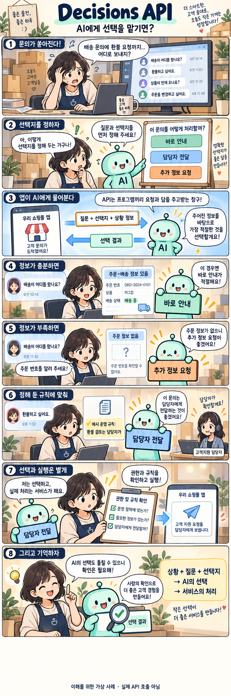
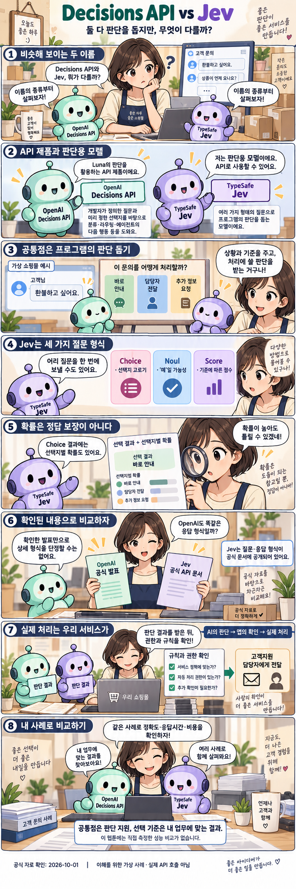

# Decisions API: AI가 정해진 선택지에서 답을 고르는 방법

확인일: 2026-10-02 (KST)

## 1. 질문과 핵심 답변

OpenAI가 발표한 Decisions API는 무엇이고 어떻게 쓰이나요?

Decisions API는 미리 정한 질문과 선택지에 맞춰 AI(Luna)의 판단을 받는 기능입니다. 글이나 이미지로 상황을 전달하면 앱이 분류나 다음 처리 경로에 사용할 답을 돌려줍니다.

예를 들어 고객 문의를 배송·환불·기타 중 어디로 보낼지 고르는 데 활용할 수 있습니다.

## 2. 쉬운 설명

건물 안내 데스크를 떠올려 보세요. 방문자가 "이거 어디서 처리하나요?"라고 물으면 안내 직원은 '배송 문의', '환불 문의', '기타 문의' 같이 미리 정해 둔 분류표를 보고 그중 하나를 골라 알려줍니다.

직원이 즉석에서 새로운 답을 지어내는 게 아니라, 정해진 선택지 중에서 가장 맞는 것을 고르는 역할만 하는 것과 비슷합니다.

### API란?

API(Application Programming Interface)는 서로 다른 프로그램이 대화하는 창구입니다. 사람이 메뉴판을 보고 음식을 주문하듯, 앱은 API에 '이런 요청을 보낼게요'라고 전달하고 API는 정해진 형식으로 결과를 돌려줍니다.

Decisions API는 그 창구 중 하나로, '이 상황에서 어떤 선택지가 맞을까?'라는 질문을 보내면 답을 받는 용도입니다.

## 3. 그림으로 이해하기

이해를 위한 가상 사례 · 실제 API 호출 아님

## 4. 비슷한 제품과 비교

Decisions API와 Jev는 둘 다 프로그램이 미리 정한 틀에 맞춰 AI의 판단을 받는 데 쓰입니다. 다만 만든 곳과, API 제품과 모델이라는 구분, 공개 문서에서 확인할 수 있는 정보의 범위가 다릅니다.

아래는 공개된 발표·문서를 바탕으로 쉽게 정리한 비교이며, 같은 사례로 직접 비교해 정확도나 속도의 우열을 가린 결과는 아닙니다.

| 비교 항목 | Decisions API | Jev |
| --- | --- | --- |
| 무엇인가 | OpenAI가 제공하는 API 제품(기반 모델 Luna) | TypeSafe가 만든 System One 모델, API로 이용 |
| 입력 | 글 또는 이미지로 된 상황 정보 | 문서상 텍스트 또는 구조화한 state(이미지 지원 여부는 이번 자료로 확인 못 함) |
| 출력 | 정해 둔 질문에 대한 사전 정의된 답 | Choice·Noul·Score 같은 확률 기반 값 |
| 확인한 자료 | 공식 발표 중심이며, 이번 자료로 상세 규격은 확인 못 함 | 공개된 API·SDK 문서에서 형식을 확인함 |
| 활용 예 | 문의 분류처럼 정해진 선택지 중 하나가 필요할 때 | 확률값으로 여러 결과를 함께 보고 싶을 때 |
| 선택 기준 | 같은 실제 사례로 정확도·응답 시간·비용을 직접 비교해야 함 | 직접 비교 결과 없음 · 이 문서는 승자를 정하지 않음 |

### Jev의 결과 형태 3가지(문서 작성자의 예시)

**Choice**

여러 처리 경로 중 하나를 고르는 값입니다. 선택 결과와 선택지별 확률을 반환합니다. 여러 질문 형식을 한 요청에 함께 보낼 수 있습니다. 예: '이 문의를 어느 경로로 보낼까?'

**Noul**

어떤 조건에 해당하는지를 확률로 나타낸 값입니다. 예: '환불 문의인가?'

**Score**

순서가 있는 단계 중 어디에 해당하는지를 확률로 가중한 값입니다. 예: '긴급도가 어느 단계인가?'

세 결과 형태 모두 확률에서 나온 값이며 정답을 보장하지 않습니다.

Decisions API와 Jev 둘 다, 판단 결과를 받은 뒤 실제로 무엇을 할지는 앱이 자신의 실행 권한과 정책을 확인해 정합니다.

이해를 위한 가상 사례 · 실제 API 호출 아님

비교 출처: [OpenAI DevDay 2026 Recap](https://openai.com/index/devday-2026-recap/) · [TypeSafe: Introducing System One Models and Jev](https://typesafe.ai/blog/introducing-system-one-models-and-jev) · [TypeSafe API Docs](https://docs.typesafe.ai/api) · [TypeSafe Quickstart](https://docs.typesafe.ai/introduction/quickstart)

## 5. 자세한 설명

2026년 9월 29일 DevDay 발표 당시에는 한정된 사전 공개 상태였으며, 이후 더 넓게 공개할 계획이라고 밝혔습니다.

이 문서 확인일(2026-10-02 KST) 기준, 이번에 확인한 공개 자료에서는 현재 이용 가능 여부, 가격, 정확한 요청 주소, SDK 형식, 보장되는 응답 속도나 정확도 같은 세부 사항을 확인하지 못했습니다.

확인하지 못했다고 해서 없다거나 미출시라고 단정하는 것은 아니며, 추가 정보가 공개되면 이 문서를 보완합니다.

## 6. 헷갈리기 쉬운 점

선택지 중 하나가 돌아와도 그 답이 항상 올바르다는 보장은 없습니다. 실수할 가능성은 다른 AI 기능과 마찬가지로 남아 있습니다.

AI가 고른 답 자체가 행동은 아닙니다. 실제로 안내를 보내거나 담당자에게 넘기는 행동은 앱이 자신의 정책과 권한을 다시 확인한 뒤에 수행합니다.

이 문서의 그림은 이해를 돕기 위해 문서 작성자가 만든 가상의 사례이며, 실제 기업의 데모나 실제 API 호출 결과가 아닙니다.

## 7. 출처와 확인일

[OpenAI DevDay 2026 Recap](https://openai.com/index/devday-2026-recap/)

확인일: 2026-10-02 (KST)
