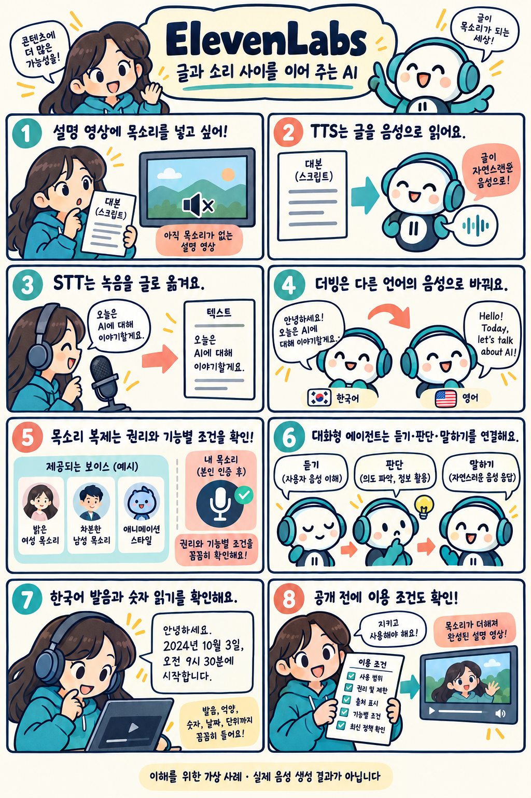

# ElevenLabs: 글을 목소리로 만드는 AI 음성 서비스

확인일: 2026-10-05 (KST)

## 1. 질문과 핵심 답변

Eleven(ElevenLabs)은 무엇이고 음성 합성·받아쓰기·더빙·대화 기능은 어떻게 다른가요?

ElevenLabs는 글을 음성으로 만드는 기능과 받아쓰기, 다른 언어로 더빙하기, 대화형 에이전트 기능을 제공하는 AI 음성 서비스입니다. 영상 내레이션을 만들거나 앱에 말로 대화하는 기능을 연결할 때 활용할 수 있습니다.

여기서는 질문의 'Eleven'을 ElevenLabs로 해석해 설명합니다.

## 2. 쉬운 설명

카페 홍보 영상 1분을 만드는 가상의 사례입니다. 준비한 원고를 읽어 줄 목소리를 골라 글을 음성 파일로 만드는 기능이 TTS입니다.

사장님 인터뷰 녹음은 STT로 글로 옮겨 자막 초안을 만듭니다. STT는 말을 글로 적는 기능이며 번역 기능이 아닙니다.

영어권 손님용 영상이 필요하면 완성된 음성을 다른 언어로 바꾸는 더빙을 사용합니다.

손님 질문에 말로 답하는 안내 창구는 음성 인식, 언어 모델, 음성 합성을 묶은 대화 에이전트로 따로 구성합니다.

### 용어: TTS·STT·더빙·에이전트

TTS는 글을 음성으로, STT는 음성을 글로 바꾸는 기능입니다. 더빙은 음성을 다른 언어로 옮기고, 에이전트는 듣고 답하는 대화 흐름을 맡습니다.

목소리 선택은 어떻게 들릴지를 정하는 일이고, 대화 에이전트의 언어 모델 선택은 무슨 내용으로 답할지를 정하는 일입니다.

## 3. 그림으로 이해하기

글을 음성으로 만들고, 받아쓰기·더빙·대화 기능을 구분하는 가상 제작 사례입니다.

이해를 위한 가상 영상 제작 사례 · 실제 제품 화면이나 음성 생성 결과가 아님

## 4. 비슷한 제품과 비교

ElevenLabs, Cartesia, Google Cloud TTS를 음성 합성과 제작 흐름의 범위로 한정해 비교합니다. 세 제품의 속도·발음·음질을 직접 비교한 결과는 아닙니다.

아래 표는 공식 문서에서 확인한 기능을 정리한 것이며, 표에 없는 기능이 없다는 뜻은 아닙니다.

ElevenLabs·Cartesia·Google Cloud TTS 비교(공식 문서 기반, 직접 성능 비교 아님)

| 비교 항목 | ElevenLabs | Cartesia | Google Cloud TTS |
| --- | --- | --- | --- |
| 한국어 합성 | 일부 TTS 모델이 한국어를 지원하며 모델마다 언어 범위가 다름 | Sonic 시리즈가 한국어를 지원 | Chirp 3: HD 음성이 한국어를 지원 |
| 목소리 만들기·복제 | 글로 묘사해 만드는 Voice Design, 녹음에서 복제하는 Instant Voice Cloning | Playground나 API로 목소리를 복제 | Chirp 3 Instant Custom Voice가 동의 녹음으로 맞춤 음성을 생성 |
| 연결 방식 | 웹 제작 도구·API, 웹·전화·앱의 대화형 에이전트 | Playground에서 목소리를 다루고 API로 음성 합성 연결 | Cloud TTS API와 스트리밍 음성 합성 |

활용 목적을 기준으로 살펴보면, 음성 제작·받아쓰기·더빙을 함께 알아볼 때는 ElevenLabs의 제작 기능을 참고할 수 있습니다. 앱에 음성 응답을 붙일 때는 Cartesia의 Sonic과 API를, Google Cloud 환경에서는 Cloud TTS를 함께 비교할 수 있습니다.

기능 범위는 서로 겹칠 수 있습니다. 실제 선택은 같은 한국어 원고로 발음·응답 속도를 확인하고 필요한 기능과 이용 조건을 비교하는 편이 좋습니다.

비교 출처: [ElevenLabs: Models](https://elevenlabs.io/docs/overview/models) · [Cartesia: TTS models](https://docs.cartesia.ai/build-with-cartesia/tts-models/latest) · [Cartesia: Clone voices](https://docs.cartesia.ai/build-with-cartesia/capability-guides/clone-voices) · [Google Cloud: Chirp 3 HD voices](https://docs.cloud.google.com/text-to-speech/docs/chirp3-hd) · [Google Cloud: Chirp 3 Instant Custom Voice](https://docs.cloud.google.com/text-to-speech/docs/chirp3-instant-custom-voice)

## 5. 자세한 설명

음성 합성에서는 읽을 원고, 목소리, 생성 모델을 선택합니다. 같은 목소리를 골라도 모델과 설정에 따라 표현 방식과 지원 언어가 달라질 수 있습니다.

한국어를 지원하는 모델에는 Multilingual v2와 Flash v2.5 등이 있습니다. 영어 전용 모델도 있으므로 한국어 원고에는 해당 언어를 지원하는 모델을 선택해야 합니다.

짧은 원고로 발음과 억양을 듣고 숫자, 날짜, 고유명사가 의도대로 읽히는지 확인하면 좋습니다. 예를 들어 카페 이름과 영업시간을 넣은 문장으로 시작할 수 있습니다.

Scribe는 녹음을 글로 옮기며 화자 구분과 단어별 시각 정보를 제공합니다. 실시간 받아쓰기와 영상 전체를 다른 언어 음성으로 바꾸는 더빙은 서로 다른 기능입니다.

더빙은 원래 화자의 특징과 배경음을 유지하며 다른 언어의 음성을 만드는 기능입니다. 공식 문서는 Dubbing v2를 Alpha 단계로 안내하며, 실시간 라이브 더빙은 지원하지 않는다고 설명합니다.

ElevenAgents는 음성 인식, 언어 모델, 음성 합성, 말 차례 조절을 연결합니다. 자료 검색과 외부 도구를 붙여 웹·전화·앱의 대화 흐름을 구성할 수 있습니다.

Voice Design은 글로 설명한 특징을 바탕으로 합성 목소리를 만듭니다. Instant Voice Cloning은 녹음에서 목소리를 복제하며, 그 목소리를 복제할 권한이 필요합니다.

Professional Voice Cloning은 본인 확인을 거쳐 자신의 목소리만 직접 만들 수 있습니다. 타인이 동의했더라도 대신 생성할 수 없으며, 상대방이 자기 계정에서 만들고 확인한 목소리를 공유하는 방식이 안내돼 있습니다.

공식 안내상 무료 요금제에서 만든 콘텐츠는 상업적으로 사용할 수 없고, 비상업 공개 시에도 출처 표시가 필요합니다. 나중에 유료로 가입해도 이전 무료 생성물의 조건은 바뀌지 않습니다.

유료 구독 중 생성한 콘텐츠는 필요한 권리를 보유하고 약관을 지키는 조건으로 상업 이용할 수 있습니다. 베타 서비스는 이 일반 허용에서 제외되며, 기능별 추가 조건도 확인해야 합니다.

## 6. 헷갈리기 쉬운 점

- 음성 합성 모델과 목소리는 다릅니다. 모델은 음성을 만드는 방식이고, 목소리는 들리는 음색과 화자의 특성입니다.

- 한국어 지원 범위는 모델·기능마다 다릅니다. 서비스 이름만 보고 모든 모델이 한국어를 지원한다고 가정하면 안 됩니다.

- 자연스럽게 말하는 것과 답변 내용이 정확한 것은 별개입니다. 대화형 에이전트에는 필요한 자료와 업무 기준도 연결해야 합니다.

- 목소리 복제 권한과 콘텐츠의 상업 이용 조건은 따로 확인해야 합니다. 무료 생성물은 나중에 유료 가입만으로 상업 이용이 허용되지 않습니다.

- 이 문서와 웹툰은 공식 자료를 바탕으로 한 설명입니다. 실제 음성 생성·복제나 제품별 음질 측정은 수행하지 않았습니다.

## 7. 출처와 확인일

확인일: 2026-10-05 (KST)

[ElevenLabs: Models](https://elevenlabs.io/docs/overview/models) · [ElevenLabs: Agents Platform overview](https://elevenlabs.io/docs/agents-platform/overview) · [ElevenLabs Help: Can I publish the content I generate on the platform?](https://help.elevenlabs.io/hc/en-us/articles/13313564601361-Can-I-publish-the-content-I-generate-on-the-platform)

추가 참고: [ElevenLabs: Speech to Text](https://elevenlabs.io/docs/overview/capabilities/speech-to-text) · [ElevenLabs: Dubbing](https://elevenlabs.io/docs/overview/capabilities/dubbing) · [ElevenLabs Help: What is My Voices?](https://help.elevenlabs.io/hc/en-us/articles/13313587528849-What-is-My-Voices) · [ElevenLabs Help: Professional Voice Clone of someone else's voice](https://help.elevenlabs.io/hc/en-us/articles/36842751624209-Can-I-create-a-Professional-Voice-Clone-of-someone-else-s-voice) · [Cartesia: TTS models](https://docs.cartesia.ai/build-with-cartesia/tts-models/latest) · [Cartesia: Clone voices](https://docs.cartesia.ai/build-with-cartesia/capability-guides/clone-voices) · [Google Cloud: Chirp 3 HD voices](https://docs.cloud.google.com/text-to-speech/docs/chirp3-hd) · [Google Cloud: Chirp 3 Instant Custom Voice](https://docs.cloud.google.com/text-to-speech/docs/chirp3-instant-custom-voice)

## 8. 이해도 확인

보기를 고르면 즉시 채점됩니다. 오답은 바로 다른 보기를 다시 선택할 수 있으며, 정답을 맞히면 해설을 확인합니다.

점수는 각 문항의 첫 선택 기준입니다. 응시 기록은 저장하지 않습니다.

### 문제 1. 준비한 안내 원고를 음성 파일로 바꾸는 기능의 이름은 무엇인가요?

1. 음성을 글로 옮기는 STT
2. 음성을 다른 언어로 옮기는 더빙
3. 글을 음성으로 만드는 TTS
4. 사람과 말로 주고받는 대화 에이전트

정답: 3번

해설: 글을 음성으로 만드는 기능이 TTS입니다. STT는 반대로 음성을 글로 옮기고, 더빙은 음성을 다른 언어로 옮기며, 대화 에이전트는 듣고 답하는 흐름을 묶은 기능입니다.

### 문제 2. 사장님 인터뷰 녹음을 같은 언어의 글 자막 초안으로 옮기려 합니다. 필요한 기능은 무엇인가요?

1. 음성을 글로 옮기는 STT
2. 글을 음성으로 만드는 TTS
3. 목소리를 새로 만드는 Voice Design
4. 완성된 영상의 음성을 다른 언어로 바꾸는 더빙

정답: 1번

해설: 녹음된 말을 글로 옮기는 기능이 STT입니다. TTS는 글을 음성으로 만들고, Voice Design은 합성 목소리를 만들며, 더빙은 음성을 다른 언어로 옮깁니다.

### 문제 3. 완성된 한국어 영상의 음성을 영어 음성으로 바꾸면서 원래 화자의 특징과 배경음을 유지하려 합니다. 이 목적에 해당하는 기능은 무엇인가요?

1. 음성을 글로 적는 STT
2. 글을 읽어 주는 TTS
3. 손님 질문에 답하는 대화 에이전트
4. 음성을 다른 언어로 옮기는 더빙

정답: 4번

해설: 더빙은 음성을 다른 언어로 옮기면서 원래 화자의 특징과 배경음 유지를 목표로 하는 기능입니다. STT는 번역 없이 말을 글로 적습니다.

### 문제 4. 손님 질문에 말로 답하는 대화 에이전트를 만들었습니다. 에이전트에서 선택한 언어 모델이 정하는 것은 무엇인가요?

1. 답변을 읽는 목소리의 음색
2. 질문에 어떤 내용으로 답할지
3. 음성을 글로 옮기는 받아쓰기 방식
4. 생성물의 상업 이용 조건

정답: 2번

해설: 대화 에이전트에서 목소리는 어떻게 들릴지를 정하고, 선택한 언어 모델은 어떤 내용으로 답할지를 정합니다.

### 문제 5. 무료 요금제 기간에 만든 음성 파일을 나중에 유료 요금제로 가입한 뒤 상업 광고에 쓰려 합니다. 이 문서가 설명한 공식 안내에 맞는 것은 무엇인가요?

1. 유료 가입 즉시 이전에 만든 음성도 상업 이용이 가능해진다
2. 원고를 직접 썼다면 요금제와 관계없이 상업 이용이 가능하다
3. 무료 기간에 만든 음성은 유료 가입만으로 상업용이 되지 않는다
4. 무료 요금제로 만든 음성은 기간 제한 없이 상업 이용이 가능하다

정답: 3번

해설: ElevenLabs 공식 안내에 따르면 무료 요금제로 생성한 음성은 나중에 유료 가입만으로 상업 이용이 허용되지 않습니다. 유료 구독 중 새로 생성하는 콘텐츠도 권리와 기능별 약관을 충족해야 합니다.
