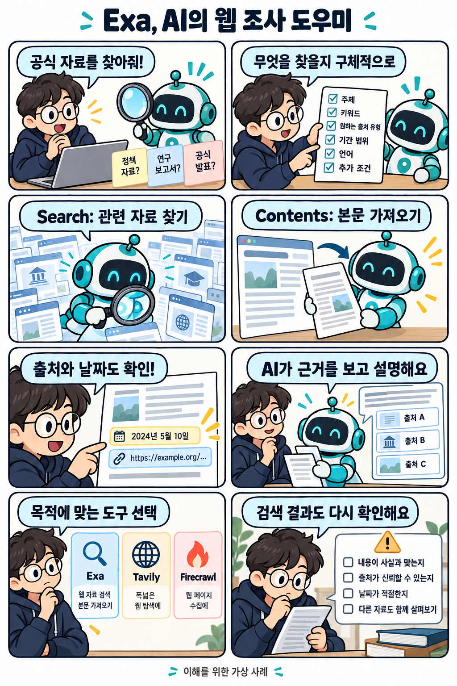

# Exa: AI를 위한 웹 검색·자료 수집 서비스

확인일: 2026-10-02 (KST)

## 1. 질문과 핵심 답변

Exa는 무엇이고 일상적인 작업에 어떻게 쓰이나요?

Exa는 AI 어시스턴트나 에이전트가 외부 웹 정보를 찾아오도록 만든 검색 서비스입니다. 자연어로 질문하면 관련 페이지를 찾아주고, 본문 전체나 핵심 발췌·요약까지 함께 받을 수 있습니다.

이미 알고 있는 URL의 내용을 읽어오는 기능(Contents)도 있어, AI가 참고 자료를 모아 답을 만드는 과정 전체를 도와줍니다.

## 2. 쉬운 설명

도서관 사서에게 "최근에 나온 이 기술 관련 공식 자료 좀 찾아줘"라고 부탁하는 상황을 떠올려 보세요. 사서(Exa)는 관련 자료를 찾아 가져다주고, AI는 그 자료를 읽고 설명을 만듭니다.

Exa 연결은 모델을 다시 학습시키는 작업이 아닙니다. 이미 학습된 AI가 외부 참고 자료를 읽어 답변하도록 돕는 것입니다.

### API와 MCP

API(Application Programming Interface)는 프로그램끼리 요청과 결과를 주고받는 창구입니다. AI 비서 프로그램이 Exa API에 '이 주제로 검색해 줘'라고 요청하면 Exa가 결과를 돌려줍니다.

MCP는 AI 앱이 외부 도구를 연결해 쓰는 표준입니다. Exa MCP는 이 표준을 사용해 AI 앱과 Exa의 검색·본문 읽기 기능을 연결해 줍니다.

## 3. 그림으로 이해하기

이해를 위한 가상 사례 · 실제 제품 화면 아님

## 4. 비슷한 제품과 비교

Exa, Tavily, Firecrawl은 모두 웹 검색과 본문 가져오기를 지원합니다. 도구별 기능 구성과 원하는 작업 흐름을 기준으로 비교할 수 있습니다.

아래는 각 제품의 공식 문서를 바탕으로 정리한 기능 비교입니다. 같은 조건으로 직접 성능을 측정하지는 않았습니다.

| 비교 항목 | Exa | Tavily | Firecrawl |
| --- | --- | --- | --- |
| 주요 역할 | 검색·근거 본문 수집·조건에 맞춘 자료 목록 작성 | 검색·본문 추출·조사 흐름(Crawl·Map·Research) | 검색·페이지 추출·사이트 수집(Crawl) |
| 겹치는 기능 | 웹 검색, 알고 있는 URL의 본문·발췌 가져오기 | 웹 검색, 알고 있는 URL의 본문·마크다운 추출 | 웹 검색, 알고 있는 URL의 본문(마크다운/HTML 등) 추출 |
| 특징적인 기능 | Websets(조건 기반 후보 찾기·검증·필드 보강), Agent(다단계 조사) | Crawl·Map(사이트 구조 탐색), Research(출처가 달린 보고서) | 접근 가능한 하위 페이지 수집(Crawl), 페이지 클릭·입력(Interact) |
| 예시 사용 목적 | 특정 조건(기술·지역 등)에 맞는 회사 목록을 자료와 함께 모으기 | 여러 페이지를 조사해 출처가 달린 요약 보고서 만들기 | 공개 문서 사이트의 연결된 여러 페이지를 읽기 좋은 형태로 수집 |

조건에 맞는 자료 목록이 필요하다면 후보 검토와 정보 보강 흐름을, 조사 보고서가 필요하다면 출처와 결과 형식을 살펴보세요. 사이트 자료를 모으는 작업에서는 페이지 탐색 범위와 본문 추출 방식을 확인하면 됩니다.

같은 실제 업무를 맡겨 필요한 자료가 나오는지, 결과를 활용하기 쉬운지, 비용이 얼마인지 비교하면 선택에 도움이 됩니다.

비교 출처: [Exa: Search API Guide](https://exa.ai/docs/reference/search-api-guide) · [Tavily: Agent Skills](https://docs.tavily.com/documentation/agent-skills) · [Tavily: Search API Reference](https://docs.tavily.com/documentation/api-reference/endpoint/search) · [Firecrawl: Introduction](https://docs.firecrawl.dev/introduction) · [Firecrawl: Search](https://docs.firecrawl.dev/features/search) · [Firecrawl: Crawl](https://docs.firecrawl.dev/features/crawl)

## 5. 자세한 설명

확인일(2026-10-02 KST) 기준 공식 문서에서 Exa Search는 자연어 질문에 맞는 웹 자료를 찾습니다. 빠른 검색부터 여러 자료를 종합하는 심화 검색까지 작업에 맞는 모드를 제공합니다.

Search는 검색 결과의 본문·관련 발췌·요약을 함께 반환하거나, 정해 둔 항목에 맞춰 정보를 정리할 수도 있습니다. Contents는 이미 알고 있는 URL의 본문을 가져오는 데 쓰므로, 검색과 본문 읽기를 반드시 두 번 나눠 요청할 필요는 없습니다.

예를 들어 새 기술 소개 글을 쓰려면 조사할 기간과 공식 출처 조건을 정하고, 후보 자료를 찾은 다음 원문을 읽습니다. 날짜와 문맥을 확인한 자료를 바탕으로 AI가 출처가 달린 설명을 작성하도록 요청할 수 있습니다.

본문 읽기에는 이전에 수집해 둔 내용인 캐시가 사용될 수 있습니다. 최신 정보를 다룰 때는 원문의 날짜와 변경 내용을 확인하고, 요약에서 빠진 조건이 없는지도 살펴봅니다.

AI 앱에서 쓰려면 해당 앱이 Exa 연결을 지원하는지 확인하고 공식 MCP 안내에 따라 연결합니다. 개발자는 API로 앱에 검색을 넣을 수 있으며, 사용할 수 있는 도구와 추가 기능은 연결 설정에 따라 달라집니다.

Websets는 특정 기술을 쓰는 특정 지역의 회사처럼 조건에 맞는 후보를 찾아 목록으로 모읍니다. 조건에 맞는지 점검하고 설립 연도나 공개 제품 분류처럼 요청한 항목을 채워 넣는 정보 보강도 지원합니다.

Websets는 코드 없이 대시보드로 쓰거나 API로 연결할 수 있고, 작업 중 결과가 차례로 쌓입니다. 여기서 검증은 지정한 조건에 맞는지 점검하는 과정이며 모든 사실의 정확성을 보장한다는 뜻은 아닙니다.

Exa Agent에는 여러 단계를 거치는 조사, 목록 작성, 정보 보강을 맡길 수 있습니다. 작업이 끝나면 설명이나 정해 둔 항목별 결과를 받는 방식입니다.

가격은 2026-10-02에 확인한 공식 요금표 기준으로 표준 Search가 1,000회 요청당 7달러(USD)이며, 요청당 최대 10개 결과가 포함됩니다. 월 구독료가 아닌 API 사용량 기준입니다.

요청당 10개를 넘긴 추가 결과는 1,000개당 1달러이고, AI 페이지 요약은 1,000페이지당 1달러가 추가됩니다. 따라서 검색 횟수만으로 전체 비용을 확정할 수는 없습니다.

Contents는 콘텐츠 종류별로 1,000페이지당 1달러입니다. 같은 URL이라도 본문과 발췌를 모두 요청하면 두 종류로 계산합니다.

Agent와 심화 검색에는 별도 요금이 적용됩니다. 이 금액은 Exa API 요금이며 연결해 쓰는 AI 앱의 구독료와 구분해야 하므로, 실제 사용할 기능의 비용은 공식 요금표에서 확인하세요.

## 6. 헷갈리기 쉬운 점

Exa가 찾아 준 자료를 AI가 참고하는 것은 모델 자체를 다시 학습시키는 작업이 아닙니다. 외부 자료를 읽고 현재 답변에 활용하는 과정입니다.

검색이나 Contents로 가져온 본문이 항상 최신판이라는 보장은 없습니다. 캐시된 페이지가 쓰일 수 있고, 모든 웹사이트나 비공개·회원제·유료 구독 콘텐츠에 항상 접근할 수 있는 것도 아닙니다.

요약이나 발췌 과정에서 맥락이 빠지거나 잘못 읽힐 수 있으므로, 중요한 사실은 원문 출처와 날짜를 다시 확인해야 합니다.

Exa MCP를 연결하는 것 자체가 모델을 다시 학습시키거나 계정·데이터에 자동으로 접근하게 만드는 것은 아닙니다. 기본 도구 외의 고급 기능은 추가 활성화나 조건이 필요할 수 있습니다.

Websets의 '검증'은 미리 정한 조건에 맞는지 확인하는 과정이며, 모든 결과 항목의 사실 여부를 완전히 보장하지는 않습니다.

가격은 검색·추가 결과·페이지 요약·Contents(콘텐츠 종류별)·Agent 등으로 항목이 나뉘어 있으므로, 전체 기능이 한 가지 가격으로 무료이거나 동일하다고 단정하면 안 됩니다. 정확한 금액은 공식 Pricing 문서에서 확인해야 합니다.

이 문서의 그림은 이해를 돕기 위해 문서 작성자가 만든 가상의 흐름이며, 실제 제품 화면이나 실제 검색 결과가 아닙니다.

## 7. 출처와 확인일

[Exa: Search API Guide](https://exa.ai/docs/reference/search-api-guide) · [Exa: Contents API Guide](https://exa.ai/docs/reference/contents-api-guide) · [Exa: Get Contents](https://exa.ai/docs/reference/get-contents) · [Exa: MCP](https://exa.ai/docs/reference/exa-mcp) · [Exa: Websets API Guide](https://exa.ai/docs/websets/api-guide) · [Exa: Agent API Guide](https://exa.ai/docs/reference/agent-api-guide) · [Exa: Pricing](https://exa.ai/docs/reference/pricing)

확인일: 2026-10-02 (KST)

## 8. 이해도 확인

웹 화면(`/explore/exa#quiz`)에서 4지선다 5문항을 풉니다. 보기를 고르면 즉시 채점되고, 오답은 바로 다른 보기를 다시 선택할 수 있습니다. 정답을 맞히면 해설이 표시됩니다.

점수는 각 문항에서 처음 채점된 답을 기준으로 계산합니다. 모두 답하면 점수와 한국 시간 기준 제출 시각을 볼 수 있으며, 응시 기록은 저장하지 않습니다.

### 1. AI가 Exa 검색 결과를 읽고 답변에 참고했습니다. 이 과정에서 Exa 검색이 제공한 것은 무엇인가요?

1. 모델을 다시 학습시켜 바꾼 내부 지식
2. 질문과 관련된 웹 자료와 출처
3. 사용자 PC에서 프로그램을 실행할 권한
4. AI 대화 앱의 유료 구독 권한

정답과 해설 보기

정답: 2번 — 질문과 관련된 웹 자료와 출처

Exa 검색은 질문과 관련된 외부 웹 자료를 찾아 AI가 참고할 수 있게 합니다. 자료 검색 자체가 모델 재학습이나 다른 서비스의 권한 부여를 뜻하지는 않습니다.

### 2. Exa Contents로 특정 페이지들의 본문을 읽으려 합니다. 읽을 대상을 지정하려면 무엇을 전달하나요?

1. 읽으려는 페이지의 URL 목록
2. 찾고 싶은 주제만 적은 검색어
3. 모델을 학습시킬 데이터 묶음
4. 검색 결과의 인기도 점수

정답과 해설 보기

정답: 1번 — 읽으려는 페이지의 URL 목록

Contents는 이미 알고 있는 URL을 전달해 본문·발췌·요약을 가져오는 기능입니다. 검색어로 페이지를 찾는 작업은 Search에서 시작합니다.

### 3. Exa가 가져온 요약에 제품 가격이 나옵니다. 현재 가격과 적용 조건을 확인하려면 어떻게 해야 하나요?

1. 검색 결과 첫 번째에 나온 가격을 그대로 사용한다
2. 요약에 적힌 숫자 하나로 전체 비용을 확정한다
3. 공식 원문의 날짜와 요금 조건을 함께 확인한다
4. 여러 요약의 가격을 평균 내서 현재 가격으로 쓴다

정답과 해설 보기

정답: 3번 — 공식 원문의 날짜와 요금 조건을 함께 확인한다

캐시된 자료가 쓰일 수 있고 요약에서 조건이 빠질 수도 있습니다. 현재 가격은 공식 원문의 날짜와 적용 조건을 함께 확인해야 합니다.

### 4. MCP 표준을 사용해 AI 앱에 Exa를 연결하는 목적은 무엇인가요?

1. 모델의 학습 데이터를 자동으로 갱신하기 위해
2. 다른 계정의 비공개 자료에 허가 없이 접근하기 위해
3. AI 앱의 구독료로 Exa의 모든 요금을 대신 내기 위해
4. AI 앱에서 Exa의 검색·본문 읽기 도구를 호출하기 위해

정답과 해설 보기

정답: 4번 — AI 앱에서 Exa의 검색·본문 읽기 도구를 호출하기 위해

MCP는 AI 앱과 외부 도구를 연결하는 표준입니다. Exa MCP는 이를 이용해 검색·본문 읽기 기능을 AI 앱에서 쓰도록 연결합니다.

### 5. 이 문서에서 조건에 맞는 회사 후보를 검토하고, 설립 연도 같은 항목을 보강해 목록으로 관리하는 Exa 기능은 무엇인가요?

1. Contents — 지정한 URL의 본문 가져오기
2. Websets — 조건에 맞는 항목을 모아 목록 관리하기
3. MCP — AI 앱과 외부 도구 연결하기
4. Highlights — 페이지에서 관련 부분 발췌하기

정답과 해설 보기

정답: 2번 — Websets — 조건에 맞는 항목을 모아 목록 관리하기

Websets는 조건에 맞는 후보를 찾고 검토한 뒤 요청한 항목을 보강해 목록으로 모읍니다. 자동 검토 결과도 중요한 사실은 원문으로 확인해야 합니다.

