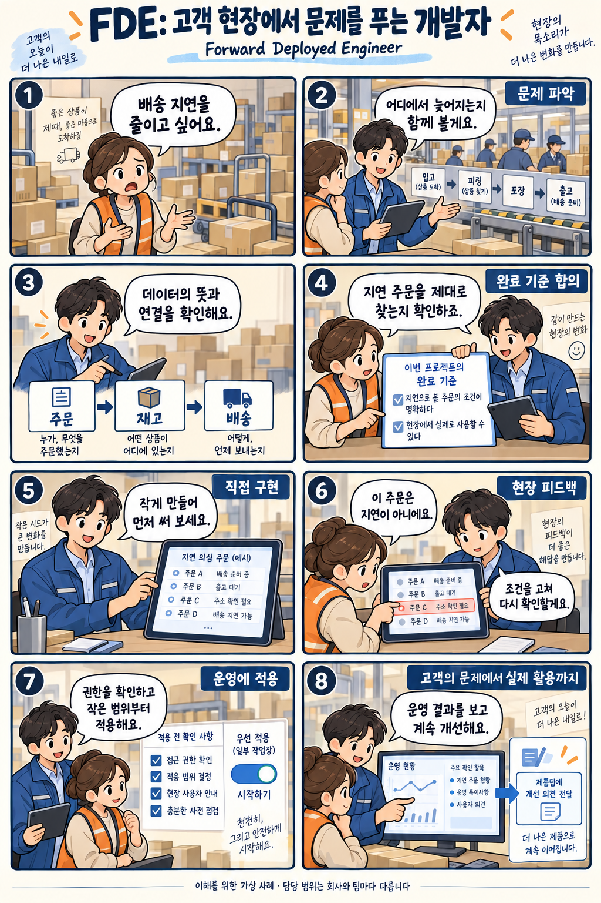

# FDE: 고객 현장에서 문제를 풀고 실제 적용까지 맡는 엔지니어

확인일: 2026-10-04 (KST)

## 1. 질문과 핵심 답변

FDE는 무엇이고 다른 엔지니어 직무와 어떻게 다른가요?

FDE(Forward Deployed Engineer)는 고객의 현실 업무·데이터·시스템을 이해하고 코드를 작성해서 실제로 쓸 수 있는 해결책으로 연결하는 직무입니다. Palantir는 FDSE(Forward Deployed Software Engineer)라는 명칭도 함께 씁니다.

FDE는 한 제품이나 AI 모델이 아니라 사람의 역할을 가리키는 말입니다. '현장'은 고객 업무에 가까이에서 협력한다는 뜻이며, 모든 FDE가 상시 출장·상주 근무를 한다는 뜻은 아닙니다.

## 2. 쉬운 설명

'배송 지연을 줄여 달라'는 요청을 받은 가상의 사례입니다. 먼저 현재 배송 과정과 어디서 지연이 생기는지 질문합니다.

주문·재고·배송 정보를 연결하고, '지연'이라는 말을 같은 뜻으로 쓰기로 정합니다. 담당자와 함께 지연 조건과 필요한 정보 목록의 기준을 합의한 뒤, 작은 화면이나 시제품을 직접 코딩합니다.

직원이 써보고 나온 오탐 원인을 보완하고, 권한과 적용 대상 범위를 정해 운영에 적용합니다. 이후 실제 업무가 개선됐는지와 장애 여부를 확인하고, 공통된 교훈을 제품팀에 전달합니다.

### 온톨로지·Hermes Agent·Herdr·FDE

온톨로지는 데이터의 뜻과 관계를 정하는 모형이고, Hermes Agent는 작업을 수행하는 AI 도구이며, Herdr는 작업창과 상태를 관리하는 도구입니다. FDE는 고객 문제에 맞는 해결책을 설계하고 적용하는 사람의 직무입니다.

FDE가 프로젝트에 맞는 도구와 데이터 모형을 선택할 수 있지만, 이 조합을 반드시 함께 써야 하는 것은 아닙니다.

## 3. 그림으로 이해하기

배송 지연 문제를 함께 파악하고 구현·현장 확인·운영 적용으로 이어지는 가상 사례입니다.

이해를 위한 가상 배송 업무 사례 · 실제 개선 성과를 측정한 결과 아님

## 4. 관련 직무와 비교

FDE, 제품 개발 엔지니어, 솔루션 엔지니어(사전영업)는 업무가 겹치고 회사마다 구체적인 범위가 다릅니다. 명칭만으로 코딩이나 운영 책임의 범위를 단정할 수 없습니다.

아래 표는 중심 문제·대표 산출물·협업 초점을 기준으로 정리한 일반적인 역할 비교이며, 모든 회사·모든 사람에게 그대로 적용되는 것은 아닙니다.

FDE·제품 개발 엔지니어·솔루션 엔지니어 비교(일반적인 역할 비교, 회사마다 다를 수 있음)

| 비교 항목 | FDE | 제품 개발 엔지니어 | 솔루션 엔지니어(사전영업) |
| --- | --- | --- | --- |
| 중심 문제 | 특정 고객 현장의 실제 업무 문제를 파악하고 해결책을 적용 | 여러 고객이 함께 쓰는 제품 기능과 공통 기반을 개발 | 고객에게 기술을 평가·안내하고 도입을 돕는 사전 단계 문제 |
| 대표 산출물 | 고객 환경에 맞춘 코드·앱, 운영 적용 결과 | 여러 고객이 쓰는 제품 기능·플랫폼 코드 | 데모·시제품, 아키텍처 안내 자료 |
| 협업 초점 | 고객 담당자와 처음 대화부터 구현·운영까지 함께함 | 여러 고객의 요구를 종합해 제품팀과 협업 | 영업·고객과 협업해 평가·도입 결정을 지원 |

제품 개발 엔지니어도 고객을 직접 만나고 피드백을 받아 제품을 만듭니다. 표는 각 직무가 주로 어디에 초점을 두는지 보여주며, 담당 업무를 엄격하게 나누는 규칙은 아닙니다.

OpenAI의 사전영업 솔루션 엔지니어 공고는 기술 평가와 데모를 강조하지만, 스타트업 대상 솔루션 엔지니어 공고는 실제 운영과 확장 지원도 다룹니다. 솔루션 엔지니어나 컨설턴트가 코딩을 하지 않는다고 단정할 수 없습니다.

비교 출처: [Palantir: Forward Deployed Software Engineer](https://jobs.lever.co/palantir/5168e8fd-fec1-4fea-b7a1-81bdaea65850) · [OpenAI: Forward Deployed Engineer (FDE)](https://openai.com/careers/forward-deployed-engineer-(fde)-sf-san-francisco/) · [OpenAI: Solutions Engineer, Pre-Sales](https://openai.com/careers/solutions-engineer-pre-sales-new-york-city/) · [OpenAI: Solutions Engineer, Startups](https://openai.com/careers/solutions-engineer-startups-san-francisco/) · [Palantir: Software Engineer, Product Development](https://jobs.lever.co/palantir/2458ba08-de79-4e8f-b553-060f9568727e)

## 5. 자세한 설명

Palantir의 공식 FDSE 공고는 고객과 직접 협력하며 아키텍처 설계, 데이터 처리, 맞춤 애플리케이션과 AI 작업 흐름을 만드는 역할을 설명합니다. 고객과의 첫 대화부터 구현과 적용까지 연결하는 것이 핵심입니다.

OpenAI의 FDE 공고도 문제 발굴, 범위 합의, 설계, 코드 작성, 운영 배포와 도입 지원을 함께 다룹니다. 반복 가능한 해결 방법을 정리하고 현장에서 얻은 피드백을 제품·연구팀에 전달하는 일도 포함합니다.

직무 이름이 같아도 회사와 팀에 따라 코딩·고객 협업·운영 지원의 비중은 다릅니다. 근무 방식이나 출장 조건도 해당 직무 설명에서 확인해야 합니다.

AI 프로젝트의 실무 예로는 자료의 품질, 대표 사례에서의 답변 정확도, 접근 권한, 처리 비용과 지연, 오류 발생 시 담당자를 살펴볼 수 있습니다. 이는 이해를 돕기 위한 점검 예이며 모든 회사의 공통 업무 규정은 아닙니다.

가상의 배송 프로젝트에서는 지연 주문을 제대로 찾는지, 담당자가 결과를 실제 업무에 활용하는지, 잘못 표시된 사례가 있는지를 확인할 수 있습니다. 구체적인 완료 기준은 고객과 합의하고, 배포 후의 담당 범위도 미리 정합니다.

모델이 질문에 답하거나 시제품이 한 번 동작한 것만으로 현장 적용이 끝나지는 않습니다. 실제 데이터의 예외, 권한, 운영 절차까지 연결해야 지속해서 쓸 수 있습니다.

## 6. 헷갈리기 쉬운 점

- FDE는 AI 모델이나 특정 기술·도구의 이름이 아니라 사람이 맡는 역할입니다. 고객 문제 파악부터 운영 적용까지를 책임지는 직무로 이해해야 합니다.

- '배송 지연을 줄여 달라'처럼 불명확한 요청을 받으면, 특정 모델을 먼저 고르거나 화면 색을 바꾸거나 모든 자동화를 바로 켜는 대신, 현재 과정·지연 기준·완료 기준을 고객과 먼저 확인해야 합니다.

- 데모가 정상적으로 동작해도 권한, 실제 데이터의 예외 상황, 장애 대응 절차를 확인하지 않았다면 운영에 필요한 조건을 더 확인해야 하며, 완료를 선언할 단계는 아닙니다.

- 여러 고객에게서 같은 문제가 반복되면 공통 패턴을 제품팀과 공유해 재사용을 검토할 수 있습니다. 다만 고객의 원본 데이터를 무단으로 공유하면 안 되며, 허용된 범위 안에서 배운 설계를 요약해 공유해야 합니다.

- 온톨로지·Hermes Agent·FDE는 각각 뜻을 정한 모형, 일하는 도구, 고객 현장에 적용하는 사람으로 역할이 다르며, 이 셋을 자동으로 동일하게 취급하면 안 됩니다.

- 이 문서의 그림은 이해를 돕기 위한 가상 배송 업무 사례이며, 실제 측정한 개선 성과나 실제 적용 결과가 아닙니다.

## 7. 출처와 확인일

확인일: 2026-10-04 (KST)

[Palantir: Forward Deployed Software Engineer](https://jobs.lever.co/palantir/5168e8fd-fec1-4fea-b7a1-81bdaea65850) · [OpenAI: Forward Deployed Engineer (FDE)](https://openai.com/careers/forward-deployed-engineer-(fde)-sf-san-francisco/)

추가 참고: [OpenAI: Solutions Engineer, Pre-Sales](https://openai.com/careers/solutions-engineer-pre-sales-new-york-city/) · [OpenAI: Solutions Engineer, Startups](https://openai.com/careers/solutions-engineer-startups-san-francisco/) · [Palantir: Software Engineer, Product Development](https://jobs.lever.co/palantir/2458ba08-de79-4e8f-b553-060f9568727e)

## 8. 이해도 확인

보기를 고르면 즉시 채점됩니다. 오답은 바로 다른 보기를 다시 선택할 수 있으며, 정답을 맞히면 해설을 확인합니다.

점수는 각 문항의 첫 선택 기준입니다. 응시 기록은 저장하지 않습니다.

### 문제 1. 이 문서에서 설명한 FDE의 중심 업무 범위는 무엇인가요?

1. 계약 가격과 결제 조건 협상에만 한정
2. 사용 설명서를 전달하는 일에만 한정
3. 고객 문제 파악부터 코드 구현과 현장 적용까지
4. 완성된 제품을 소개하는 시연에만 한정

정답: 3번

해설: FDE는 고객 현장의 실제 업무를 파악하고 코드를 작성해 실제로 쓸 수 있는 해결책으로 연결하고 운영 적용까지 맡는 사람의 역할입니다.

### 문제 2. 고객이 '배송 지연을 줄여 달라'고 불명확하게 요청했습니다. FDE가 가장 먼저 해야 할 행동은 무엇인가요?

1. 현재 배송 과정과 지연·완료 기준을 고객과 함께 확인한다
2. 써볼 AI 모델을 가장 먼저 고른다
3. 관리 화면의 색상을 먼저 바꾼다
4. 가능한 자동화를 전부 바로 켠다

정답: 1번

해설: 불명확한 요청을 받으면 특정 모델이나 화면 변경, 전체 자동화보다 먼저 현재 과정과 지연·완료 기준을 고객과 확인해야 합니다.

### 문제 3. 시제품 데모가 오류 없이 동작했지만 운영 권한, 실제 데이터의 예외 상황, 장애 대응 절차는 아직 확인하지 않았습니다. 이 상태를 가장 정확히 설명한 것은 무엇인가요?

1. 데모가 통과했으므로 운영까지 완료된 것으로 선언할 수 있다
2. 권한·장애 대응은 FDE가 신경 쓸 필요가 없는 영역이다
3. 예외 상황 확인은 고객이 전적으로 알아서 할 일이다
4. 운영에 필요한 조건을 추가로 더 확인해야 하는 상태다

정답: 4번

해설: 데모 통과와 운영 완료는 다릅니다. 권한, 실제 데이터의 예외 상황, 장애 대응 절차까지 확인해야 운영에 필요한 조건을 갖춘 것으로 볼 수 있습니다.

### 문제 4. 여러 고객에게서 같은 문제가 반복되는 것을 확인했습니다. FDE가 할 수 있는 적절한 행동은 무엇인가요?

1. 고객의 원본 데이터를 그대로 다른 고객에게 공유한다
2. 허용된 범위 안에서 배운 설계를 요약해 제품팀과 공유한다
3. 반복되는 문제는 각 고객 담당자가 알아서 해결하게 둔다
4. 공통 패턴은 FDE 개인만 알고 있어야 한다

정답: 2번

해설: 고객 원본 데이터를 무단으로 공유하면 안 되지만, 허용된 범위에서 배운 설계를 요약해 제품팀과 공유해 재사용을 검토할 수 있습니다.

### 문제 5. 온톨로지·Hermes Agent·FDE의 역할을 차례대로 올바르게 짝지은 것은 무엇인가요?

1. 작업 수행 도구 · 고객 적용을 맡는 직무 · 의미를 정한 모형
2. 고객 적용을 맡는 직무 · 의미를 정한 모형 · 작업 수행 도구
3. 의미를 정한 모형 · 작업 수행 도구 · 고객 적용을 맡는 직무
4. 의미를 정한 모형 · 고객 적용을 맡는 직무 · 작업 수행 도구

정답: 3번

해설: 온톨로지는 데이터의 뜻을 정하는 모형, Hermes Agent는 작업을 수행하는 도구, FDE는 고객 현장에 해결책을 적용하는 사람의 역할로 서로 구분됩니다.
