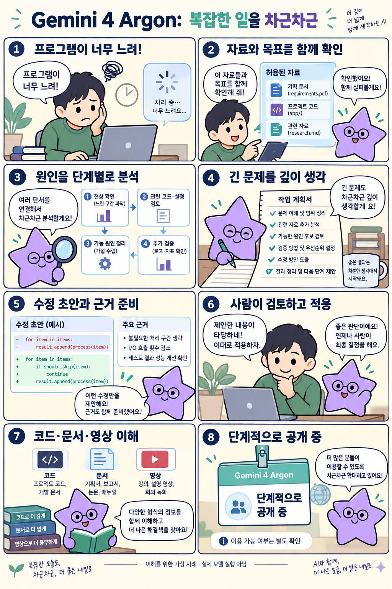

# Gemini 4 Argon: 길고 복잡한 추론에 초점을 둔 Google DeepMind 모델

확인일: 2026-10-02 (KST)

## 1. 질문과 핵심 답변

Google의 Gemini 4 Argon은 무엇이고 기존 모델과 어떻게 다른가요?

Gemini 4 Argon은 Google DeepMind가 2026년 9월 30일 발표한 모델로, 복잡한 문제를 여러 단계에 걸쳐 처리하도록 설계됐습니다. 코딩, 문서·차트 분석, 긴 영상 이해와 보안 방어가 주요 활용 분야입니다.

공식 발표의 최대 100만 토큰은 출력 한도이며, 입력 용량과 구분해야 합니다.

## 2. 쉬운 설명

큰 숙제를 여러 단계로 나누어 풀어내는 연구원에 비유할 수 있습니다. 느린 프로그램의 자료를 읽고 원인 후보와 수정안을 만드는 일처럼, 긴 문제를 계속 다루도록 설계된 모델입니다.

이해를 돕는 그림은 가상의 사례이며, 실제 자동 실행 범위는 연결한 도구와 허용 권한에 따라 달라집니다.

### 모델과 에이전트의 차이

Argon 자체는 추론을 담당하는 모델이며, dots 같은 '에이전트 제품'과는 다릅니다. 에이전트 제품은 모델을 바탕으로 도구를 다루고 작업을 이어가는 서비스이고, 모델은 그 안에서 쓰이는 두뇌에 해당합니다.

즉 Argon이 있다고 해서 자동으로 PC를 조작하는 에이전트가 되는 것은 아닙니다.

## 3. 그림으로 이해하기

이해를 위한 가상 사례 · 실제 제품 화면 아님

## 4. 비슷한 제품과 비교

세 모델은 목적과 공개 방식, API 단가가 다릅니다. Argon은 장기 코딩·문서·추론, Astra는 복잡 추론·코딩·컴퓨터 사용·연구·문서, Opus 5.5는 코딩과 긴 에이전트 작업·업무 문서에 강점을 둡니다.

공개 방식도 Argon은 Fairwind 우선 제공 후 유료 API·Ultra로 확대할 예정이고, Astra와 Opus 5.5는 API 문서가 이미 공개돼 있습니다.

| 비교 항목 | Gemini 4 Argon | GPT-6 Astra | Claude Opus 5.5 |
| --- | --- | --- | --- |
| 목적 | 장기 코딩·문서·추론 | 복잡 추론·코딩·컴퓨터 사용·연구·문서 | 코딩·긴 에이전트 작업·업무 문서 |
| 공개/접근 | Fairwind 우선, 유료 API·Ultra로 확대 예정(일반 공개일 미확인) | API 문서 공개 | Claude 유료·API |
| 표준 입력 단가(100만 토큰) | 도입가 $2 → 이후 $4 | $10 | $4 |
| 표준 출력 단가(100만 토큰) | 도입가 $10 → 이후 $20 | $50 | $20 |

Astra는 입력이 272K 토큰을 넘으면 입력 단가가 2배, 출력 단가가 1.5배로 올라간다는 조건이 있습니다(캐시·Batch·Fast 단가 비교는 이 표에 포함하지 않았습니다).

표의 금액은 미국 달러(USD) 기준 API 단가이며, 구독 요금이나 작업 한 건의 총비용이 아닙니다. 실제 비용은 사용한 토큰 수와 도구, 실행 조건에 따라 달라집니다.

세 모델 모두 코딩과 문서 업무에 활용할 수 있습니다. 지금 이용 가능한 모델부터 같은 업무를 맡겨 보고, 결과의 품질·연결 도구·처리 시간·총비용을 비교하면 선택하기 쉽습니다.

이 문서에서 세 모델을 같은 조건으로 직접 실행해 성능을 비교한 것은 아닙니다.

비교 출처: [Google: Gemini 4 Argon (KR)](https://blog.google/intl/ko-kr/products/gemini-4-argon-kr/) · [Google: Gemini 4 Argon](https://blog.google/innovation-and-ai/models-and-research/gemini-models/gemini-4-argon/) · [OpenAI: GPT-6 Astra API docs](https://developers.openai.com/api/docs/models/gpt-6-astra) · [Anthropic: Claude Opus 5.5](https://www.anthropic.com/claude-opus-5-5)

## 5. 자세한 설명

확인일(2026-10-02 KST) 기준 공개 자료를 보면, Google은 보안 방어 영역에서 신뢰하는 보안 전문가 그룹(Fairwind)에 우선 제공하고, 유료 API와 AI Ultra 요금제로는 순차적으로 넓혀갈 계획이라고 밝혔습니다.

다만 한국의 모든 계정이 지금 바로 쓸 수 있다고 단정할 근거는 없으며, 정확한 API ID나 일반 공개 날짜는 이번 자료로 확인하지 못했습니다.

가격은 발표 기준 입력 100만 토큰당 $2, 출력 100만 토큰당 $10이며 캐시된 입력은 95% 할인된다고 발표했습니다. 이를 계산하면 입력 100만 토큰당 $0.10입니다.

다만 이 가격은 도입 기간 동안의 가격이고, 도입 기간이 끝나면 입력 $4·출력 $20으로 오른다는 내용이 영문 각주에 있습니다. 도입 기간이 정확히 언제 끝나는지는 확인하지 못했으며, 이 토큰 단가는 별도의 구독 요금제(AI Ultra 등)와는 구분됩니다.

공급사가 공개한 벤치마크로 DeepSWE v1.1 77.9%, AutomationBench 51.3%, LVBench 91.7%, CWE-bench v1 68% 등이 있으나, 이는 발표 자료의 수치이며 모든 업무에서의 정확도를 보장하지도 않고 이 문서에서 독립적으로 재검증한 결과는 아닙니다.

## 6. 헷갈리기 쉬운 점

출력 최대 100만 토큰은 한 번의 응답에서 만들 수 있는 출력량에 대한 한도이며, 모델이 한 번에 읽어들이는 입력(컨텍스트) 한도와 혼동하면 안 됩니다.

DeepSWE v1.1, AutomationBench, LVBench, CWE-bench v1 수치는 모두 공급사가 공개한 발표 자료의 결과이며, 이 문서에서는 재검증하지 않았으며 모든 실제 업무에서의 정확도를 보장하지 않습니다.

보안 전문가 그룹(Fairwind) 우선 제공과 유료 API·AI Ultra로의 순차 확대는 계획으로 설명되어 있을 뿐, 한국의 모든 계정이 지금 바로 이용할 수 있다고 단정할 수 없습니다.

정확한 API ID나 일반 공개 날짜는 확인하지 못했습니다.

발표된 입력 $2·출력 $10(캐시 계산상 $0.10) 가격은 도입 기간 동안의 가격이며, 도입 기간이 끝나면 입력 $4·출력 $20으로 오릅니다.

도입 기간 종료일은 확인하지 못했고, 이 토큰 단가는 별도의 구독 요금제와 구분됩니다.

API 단가 비교는 공급사가 발표한 표준 단가 기준이며, 캐시·Batch·Fast 같은 조건별 단가나 실제 추론 토큰 사용량까지 반영한 총비용 비교는 아닙니다.

Argon은 모델이며, 일반 이용자 모두에게 무제한 출력을 제공하거나 PC를 자동으로 조작하는 기능이 아닙니다. dots 같은 에이전트 제품과는 구분해서 이해해야 합니다.

이 문서의 그림은 이해를 돕기 위해 문서 작성자가 만든 가상의 흐름이며, 실제 제품 화면이나 실제 처리 결과가 아닙니다.

## 7. 출처와 확인일

[Google: Gemini 4 Argon (KR)](https://blog.google/intl/ko-kr/products/gemini-4-argon-kr/) · [Google: Gemini 4 Argon](https://blog.google/innovation-and-ai/models-and-research/gemini-models/gemini-4-argon/)

확인일: 2026-10-02 (KST)

## 8. 이해도 확인

웹 화면(`/explore/gemini-4-argon#quiz`)에서 4지선다 5문항을 풀고 점수·한국 시간 기준 제출 시각·정답 해설을 확인합니다. 결과는 현재 화면에서만 표시되며 저장하지 않습니다.

### 1. Gemini 4 Argon이 발표한 최대 100만 토큰은 어떤 한도인가요?

1. 모델이 한 번에 읽어들이는 입력(컨텍스트) 한도
2. 한 번의 응답에서 만들 수 있는 출력 한도
3. 하루에 보낼 수 있는 요청 횟수 한도
4. 저장할 수 있는 파일 용량 한도

정답과 해설 보기

정답: 2번 — 한 번의 응답에서 만들 수 있는 출력 한도

발표의 최대 100만 토큰은 출력 한도이며, 모델이 읽어들이는 입력(컨텍스트) 한도와는 다른 수치라고 구분하고 있습니다.

### 2. Argon 모델과 dots 같은 에이전트 제품의 관계는?

1. 모델은 에이전트가 쓰는 두뇌 역할이며, Argon이 있다고 자동으로 에이전트가 되는 것은 아니다
2. Argon 자체가 곧 에이전트 제품이다
3. 모델과 에이전트는 완전히 같은 개념이다
4. 에이전트는 모델 없이도 항상 동작한다

정답과 해설 보기

정답: 1번 — 모델은 에이전트가 쓰는 두뇌 역할이며, Argon이 있다고 자동으로 에이전트가 되는 것은 아니다

Argon은 추론을 담당하는 모델이고, 에이전트 제품은 모델을 바탕으로 도구를 다루고 작업을 이어가는 서비스로 구분됩니다.

### 3. DeepSWE v1.1, AutomationBench 같은 벤치마크 수치를 볼 때 유의할 점은?

1. 모든 실제 업무에서의 정확도를 보장한다
2. 벤치마크는 항상 100% 신뢰할 수 있는 절대 기준이다
3. 공급사가 공개한 발표 자료의 수치이며 이 문서가 독립적으로 재검증하지 않았다
4. 벤치마크 수치는 가격과 동일한 의미다

정답과 해설 보기

정답: 3번 — 공급사가 공개한 발표 자료의 수치이며 이 문서가 독립적으로 재검증하지 않았다

공급사가 공개한 발표 자료의 수치이며, 모든 업무에서의 정확도를 보장하지 않고 이 문서에서 재검증한 결과도 아닙니다.

### 4. API 가격 비교표를 실제 도입 비용으로 해석할 때, 올바른 설명은 무엇인가요?

1. 토큰 단가가 낮으면 모든 작업의 총비용도 항상 가장 낮다
2. API 토큰 단가와 AI 구독 요금은 같은 비용이다
3. 표에 나온 단가만으로 작업의 정확한 총비용을 알 수 있다
4. 실제 총비용은 토큰 사용량·도구·실행 조건도 함께 봐야 한다

정답과 해설 보기

정답: 4번 — 실제 총비용은 토큰 사용량·도구·실행 조건도 함께 봐야 한다

표의 단가는 100만 토큰당 API 가격일 뿐이며, 실제 작업 비용은 토큰 사용량·도구 연결·실행 조건에 따라 달라집니다.

### 5. Google이 보안 방어 영역에서 Argon을 처음 제공한 대상은 누구인가요?

1. 모든 일반 이용자에게 동시에 공개
2. 신뢰하는 보안 전문가 그룹(Fairwind)에 우선 제공 후 유료 API·Ultra로 확대
3. 오직 내부 개발자에게만 비공개로 제공
4. 별도 신청 없이 전 세계 API 키에 자동 적용

정답과 해설 보기

정답: 2번 — 신뢰하는 보안 전문가 그룹(Fairwind)에 우선 제공 후 유료 API·Ultra로 확대

Google은 신뢰하는 보안 전문가 그룹(Fairwind)에 우선 제공하고, 유료 API와 AI Ultra 요금제로는 순차적으로 넓혀갈 계획이라고 밝혔습니다.

