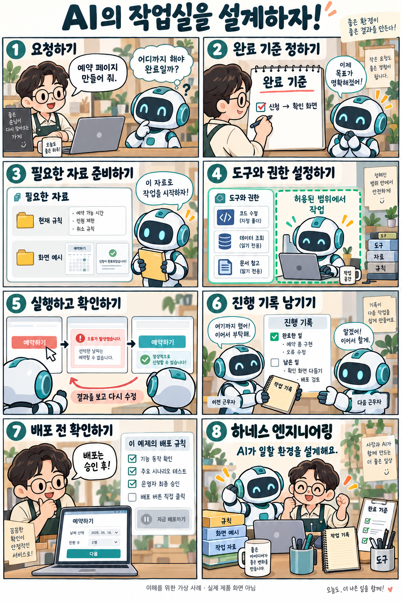

# 하네스 엔지니어링: AI가 일을 끝까지 하도록 만드는 작업 환경

확인일: 2026-10-04 (KST)

## 1. 질문과 핵심 답변

하네스 엔지니어링은 무엇이고 왜 필요한가요?

하네스 엔지니어링은 AI가 필요한 자료와 도구를 쓰고, 정해진 범위에서 작업하며, 결과를 확인하고 다음 작업으로 이어가게 만드는 주변 실행 환경을 설계·개선하는 일입니다. 이 설명은 공식 표준 정의가 아니라, OpenAI와 Anthropic이 공개한 사례들을 종합해 쉽게 풀어 쓴 것입니다.

여기서 말하는 하네스는 자동차의 배선 뭉치가 아니라, AI 에이전트가 일하는 주변 환경을 가리키는 말입니다. AI 에이전트는 계획을 세우고 도구를 실행하고 결과를 관찰하는 과정을 반복하는 프로그램입니다.

## 2. 쉬운 설명

이 설명은 이해를 돕기 위한 비유입니다. 요리사는 AI 모델, 손님이 보낸 주문서는 프롬프트에 해당합니다.

오늘의 레시피, 냉장고에 있는 재료, 손님의 알레르기 정보는 컨텍스트입니다. 지금 이 요청에 필요한 정보만 요리사에게 전달해야 요리가 제대로 나옵니다.

주방의 도구, 정해진 작업 절차, 중간 점검, 교대할 때 남기는 기록 전체를 합친 것이 하네스입니다. 요리사가 바뀌어도 주방 환경과 절차가 잘 갖춰져 있으면 일이 끝까지 이어집니다.

### AI 에이전트란?

AI 에이전트는 한 번 대답하고 끝나는 것이 아니라, 계획을 세우고 도구를 실행하고 결과를 관찰하는 과정을 여러 번 반복하는 프로그램입니다.

하네스 엔지니어링은 이 반복 과정에서 AI가 무엇을 읽고, 어디까지 손댈 수 있고, 결과를 어떻게 확인하고, 다음 단계로 어떻게 이어갈지를 미리 설계하는 일입니다.

## 3. 그림으로 이해하기

이해를 위한 가상 사례 · 실제 실행 결과나 제품 화면 아님

## 4. 관련 개념과 비교

프롬프트 엔지니어링, 컨텍스트 엔지니어링, 하네스 엔지니어링은 경쟁하는 제품이 아니라 서로 겹치는 관점입니다. 무엇을 설계 대상으로 보느냐가 다를 뿐, 우열을 가릴 성격의 비교는 아닙니다.

아래 표는 가상의 예약 페이지 예제를 기준으로 세 관점이 각각 어디에 집중하는지 비교합니다.

| 비교 항목 | 프롬프트 엔지니어링 | 컨텍스트 엔지니어링 | 하네스 엔지니어링 |
| --- | --- | --- | --- |
| 주로 묻는 질문 | 지시를 어떻게 더 명확하게 쓸까? | 지금 이 작업에 어떤 정보를 선별해 전달할까? | AI가 어떤 도구·권한·확인 절차 안에서 일하게 할까? |
| 설계 대상 | 지시문 작성과 구성 | 모델에게 줄 지시·문서·도구 결과·기록 등 정보의 선별과 관리 | 자료 접근·도구·권한 범위·진행 기록·결과 확인까지 포함한 실행 흐름 전체 |
| 예약 페이지 예시 | '이름·날짜 입력 후 신청 시 확인 화면을 보여줘'처럼 요청 문장을 명확히 쓴다 | 현재 예약 규칙과 관련 화면 코드만 골라 전달한다 | 편집 가능한 폴더를 정하고, 브라우저 확인 도구로 결과를 보고, 실패를 기록하고, 배포 전 사람 승인을 거치게 한다 |
| 실패했을 때 살펴볼 것 | 지시 문장이 모호하거나 빠진 조건이 있는지 | 전달한 정보가 오래됐거나 필요한 자료가 빠지지 않았는지 | 권한 범위, 확인 절차, 기록·중단 조건 같은 실행 환경 자체에 문제가 없는지 |

지시가 모호하면 문장을 다듬고, 자료가 오래됐으면 정보를 갱신하며, 실행·복구가 끊기면 작업 환경을 고칩니다.

하네스 엔지니어링은 지시문과 전달 정보를 포함해 활용하면서, 거기에 더해 실행 흐름·도구 권한·결과 확인·경계까지 함께 설계합니다. 상황에 맞게 세 관점을 함께 쓰는 것이 자연스럽습니다.

비교 출처: [OpenAI: Harness engineering](https://openai.com/index/harness-engineering/) · [Anthropic: Effective harnesses for long-running agents](https://www.anthropic.com/engineering/effective-harnesses-for-long-running-agents) · [Anthropic: Effective context engineering for AI agents](https://www.anthropic.com/engineering/effective-context-engineering-for-ai-agents) · [Anthropic: Harness design for long-running apps](https://www.anthropic.com/engineering/harness-design-long-running-apps)

## 5. 자세한 설명

목표와 완료 기준: 가상의 예약 페이지 예제에서 완료 기준은 '이름과 날짜를 입력하고 신청하면 확인 화면이 뜬다'처럼 명확하게 정합니다. 완료 기준이 분명해야 AI도, 확인하는 사람도 같은 잣대로 일이 끝났는지 판단할 수 있습니다.

정보 찾기: AI에게는 지금 작업에 필요한 현재 규칙과 화면 자료만 전달합니다. 오래된 문서나 관련 없는 코드까지 한꺼번에 주면 오히려 헷갈리므로, 작업에 맞는 자료를 그때그때 골라 주는 것이 좋습니다.

도구와 권한 제한: 이 예제에서는 AI가 정해진 폴더의 파일만 편집할 수 있고, 화면을 직접 확인할 수 있는 브라우저 확인 도구만 쓸 수 있도록 제한합니다. 배포나 결제 같은 되돌리기 어려운 작업 권한은 주지 않고, 그 단계는 사람이 맡습니다.

결과 관찰·확인·피드백: 작업은 큰 덩어리로 한꺼번에 시키지 않고 작은 단위로 나눠 시킵니다. 예약 신청 버튼을 눌러본 뒤 확인 화면이 뜨는지 직접 관찰하고, 실패하면 그 내용을 기록해 다음 수정에 반영합니다.

진행 보존·복구와 중복 방지: 작업을 교대하거나 다음 세션으로 넘길 때는 완료한 일, 아직 남은 일, 실패한 시도를 함께 남깁니다. 이렇게 기록을 남겨야 다음에 같은 조사나 수정을 처음부터 반복하지 않습니다.

비용·시간·반복 횟수와 중단 조건: 작업에 맞는 사용량·시간 한도와, 같은 실패가 반복될 때 멈추거나 사람에게 알릴 조건을 정할 수 있습니다. 이는 운영 설계의 예이며 모든 작업에 같은 한도가 맞는 것은 아닙니다. 이 예약 예제에서는 배포 전 사람 승인을 거칩니다.

모델이 좋아질수록 하네스도 바뀝니다: OpenAI의 하네스 엔지니어링 글에서는, 더 나은 모델일수록 세세하게 단계를 나눠주는 보조 장치를 줄이고 더 큰 단위의 작업을 맡길 수 있다고 설명합니다. 구체적인 성능 수치보다는, 하네스를 한 번 정해두고 끝내는 것이 아니라 모델이 좋아지는 만큼 다시 손봐야 한다는 점이 핵심입니다.

## 6. 헷갈리기 쉬운 점

긴 프롬프트를 쓰는 것과 하네스를 설계하는 일은 같지 않습니다. 지시문을 길게 쓰는 것만으로 도구 권한·확인 절차·진행 기록까지 갖춰지지는 않습니다.

하네스를 손본다고 모델 자체가 다시 학습되는 것은 아닙니다. 모델의 학습 가중치는 그대로이고, 주변 실행 환경만 바뀝니다.

AI에게 제한 없는 권한을 주는 것이 하네스 엔지니어링은 아닙니다. 어떤 작업을 자동으로 허용하고 어떤 작업에 승인이 필요한지는 정책과 실행 환경에서 정합니다. 이 예약 예제에서는 배포 전 사람 승인을 거칩니다.

참여하는 AI나 팀원이 많다고 항상 더 좋은 결과가 나오는 것은 아닙니다. 실패 원인과 작업 난이도에 맞는 최소한의 구조로 설계하는 것이 중요합니다.

AI가 '완료했다'고 말하는 것 자체는 완료의 증거가 아닙니다. 정해둔 완료 기준으로 실제 결과를 확인해야 합니다.

이 문서의 예약 페이지 예제에서 설명한 방식이 모든 작업에서 같은 성과를 보장하지는 않습니다. 실패 원인과 작업 조건에 맞게 구조를 다시 설계해야 합니다.

## 7. 출처와 확인일

[OpenAI: Harness engineering](https://openai.com/index/harness-engineering/) · [Anthropic: Effective harnesses for long-running agents](https://www.anthropic.com/engineering/effective-harnesses-for-long-running-agents) · [Anthropic: Effective context engineering for AI agents](https://www.anthropic.com/engineering/effective-context-engineering-for-ai-agents) · [Anthropic: Harness design for long-running apps](https://www.anthropic.com/engineering/harness-design-long-running-apps)

확인일: 2026-10-04 (KST)

## 8. 이해도 확인

웹 화면(`/explore/harness-engineering#quiz`)에서 4지선다 5문항을 풉니다. 보기를 고르면 즉시 채점되고, 오답은 바로 다른 보기를 다시 선택할 수 있습니다. 정답을 맞히면 해설이 표시됩니다.

점수는 각 문항에서 처음 채점된 답을 기준으로 계산합니다. 모두 답하면 점수와 한국 시간 기준 제출 시각을 볼 수 있으며, 응시 기록은 저장하지 않습니다.

### 1. 같은 AI 모델에 작업 도구·권한 범위·진행 기록·결과 확인 절차를 연결했습니다. 이 변경은 무엇을 설계한 것인가요?

1. 모델의 학습 가중치
2. 사용자 질문의 맞춤법
3. AI가 일하는 하네스
4. 화면 글꼴과 색상만

정답과 해설 보기

정답: 3번 — AI가 일하는 하네스

모델 자체(학습 가중치)는 바꾸지 않았습니다. 도구·권한·기록·확인 절차를 연결한 것은 AI가 일하는 주변 실행 환경인 하네스를 설계한 것입니다.

### 2. AI가 오래된 예약 규칙을 참고해 작업했습니다. 현재 규칙과 필요한 코드만 골라 전달하는 일은 어느 관점의 핵심인가요?

1. 컨텍스트 엔지니어링: 참고할 정보 선택·관리
2. 프롬프트의 문장 길이만 늘리기
3. 모델의 학습 횟수 늘리기
4. 브라우저 창 크기 조절하기

정답과 해설 보기

정답: 1번 — 컨텍스트 엔지니어링: 참고할 정보 선택·관리

지금 필요한 규칙·문서·코드만 골라 전달하는 일은 컨텍스트 엔지니어링의 핵심입니다. 무조건 많이 담는 것이 좋은 것은 아닙니다.

### 3. 예약 신청 기능의 완료 기준이 신청 후 확인 화면 표시입니다. AI가 코드를 고치고 완료라고 말했습니다. 이 기준을 확인할 직접적인 근거는 무엇인가요?

1. 수정한 코드의 줄 수
2. AI가 답변한 문장의 길이
3. 작업에 참여한 AI의 수
4. 실제로 신청했을 때 나타나는 확인 화면

정답과 해설 보기

정답: 4번 — 실제로 신청했을 때 나타나는 확인 화면

'완료'라는 말 자체는 완료의 증거가 아닙니다. 정해둔 완료 기준대로 실제로 신청해 확인 화면이 뜨는지 봐야 합니다.

### 4. 작업이 다음 세션으로 넘어갈 예정입니다. 같은 일을 반복하지 않고 이어가려면 무엇을 남겨야 하나요?

1. 처음의 요청 문장만
2. 완료한 일·남은 일·실패 내용과 변경 이력
3. 사용한 모델의 이름만
4. 잘될 것이라는 자신감 점수만

정답과 해설 보기

정답: 2번 — 완료한 일·남은 일·실패 내용과 변경 이력

완료한 일, 남은 일, 실패 기록과 변경 이력을 남겨야 다음 세션이 처음부터 다시 하지 않고 이어갈 수 있습니다.

### 5. 예약 페이지 예제의 정책이 배포 전 사람 승인입니다. 기능 확인이 통과했지만 승인은 아직 없습니다. 하네스는 어떻게 처리해야 하나요?

1. 승인 없이 바로 배포한다
2. 기능 확인 통과를 사람 승인으로 대신한다
3. 승인이 필요한 배포 단계에서 멈추고 승인을 기다린다
4. 승인 조건을 지우고 배포한다

정답과 해설 보기

정답: 3번 — 승인이 필요한 배포 단계에서 멈추고 승인을 기다린다

이 예제의 정책은 배포 전 사람 승인입니다. 기능 확인 통과와 승인은 다른 절차이므로, 승인이 필요한 단계에서 멈추고 기다려야 합니다. 모든 하네스에 항상 사람 승인이 필수인 것은 아니며, 이는 이 예제의 정책입니다.

