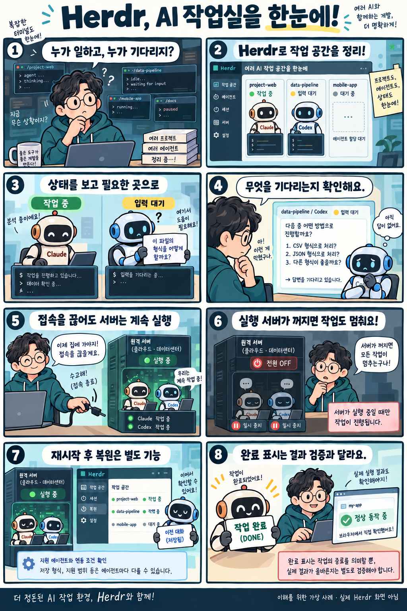

# Herdr: 여러 AI 코딩 작업을 한곳에서 관리하는 도구

확인일: 2026-10-04 (KST)

## 1. 질문과 핵심 답변

Herdr는 무엇이고 여러 AI 코딩 작업을 관리할 때 어떻게 쓰나요?

Herdr는 Claude Code·Codex 등 여러 코딩 에이전트의 터미널과 작업 상태를 한곳에서 관리하는 도구입니다. 기존 AI 도구를 각 창에서 실행하고, 어느 작업이 진행 중이거나 입력을 기다리는지 살펴볼 수 있습니다.

터미널은 명령어를 입력하고 실행 결과를 보는 창입니다. Herdr는 이 창들과 실행 중인 프로그램을 관리하며, AI 모델 자체를 제공하거나 다시 학습시키는 도구는 아닙니다.

## 2. 쉬운 설명

책상 위에 여러 프로젝트 창을 띄워 놓고 일하는 상황을 떠올려 보세요. 한 창에서는 Claude Code가 코드를 작성하고, 다른 창에서는 Codex가 내용을 살펴보는 가상 사례입니다.

Herdr에서 입력을 기다리는 창을 찾아 어떤 질문이나 승인이 필요한지 확인할 수 있습니다. 작업이 끝났다는 표시가 보이면 실제 산출물과 동작을 따로 확인합니다. 이 예시는 실제로 이 프로젝트에 Herdr를 연결한 결과가 아닙니다.

### 작업공간·탭·창과 상태값

Herdr의 구조는 작업공간(workspace) 안에 여러 탭(tab)이 있고, 각 탭 안에 창(pane, 실제 터미널)이 있는 형태입니다. Claude Code나 Codex 같은 CLI 도구는 이 창 안에서 그대로 실행됩니다.

공식 문서에 나오는 상태값은 working(작업 중), blocked(입력·승인·결정을 기다림), done(끝난 후 아직 확인하지 않음), idle(입력 가능), unknown(상태를 판별하지 못함) 다섯 가지입니다. 이 상태는 화면 아래쪽 정보나 프로세스를 읽어 판별하거나, 지원하는 에이전트와의 연동으로 보고받아 표시되며, 업무 정확도나 완료 검증을 보장하는 신호는 아닙니다.

## 3. 그림으로 이해하기

이해를 위한 가상 사례 · 실제 Herdr 화면 아님

## 4. 비슷한 제품과 비교

Herdr, tmux, Zellij는 모두 터미널 화면 접속을 끊어도(detach) 뒤에서 계속 실행해 둘 수 있는 터미널 관리 도구입니다. 다만 각자 중심으로 두는 역할과 재시작 후 복원되는 범위가 다릅니다.

아래 표는 공식 문서를 바탕으로 정리한 비교이며, 같은 조건으로 직접 성능을 측정한 결과는 아닙니다.

| 비교 항목 | Herdr | tmux | Zellij |
| --- | --- | --- | --- |
| 중심 역할 | AI 에이전트 CLI의 터미널·상태를 작업공간·탭·창으로 관리 | 여러 프로그램을 터미널 안에서 전환하며 다루는 범용 터미널 관리 | 탭·창·레이아웃과 플러그인 중심의 터미널 관리 |
| 화면 연결 해제 | 접속 화면을 끊어도 서버의 프로세스는 계속 실행 | detach로 접속을 끊어도 백그라운드에서 계속 실행 | 접속을 끊어도 세션이 백그라운드에서 유지 |
| 재시작·복원 | 서버 재시작 시 원래 프로세스는 사라짐, 창 배치는 복원 가능, 대화 재개는 지원 에이전트·연동 조건에 따름 | 공식 위키 기준 접속 해제·재접속(reattach) 중심, 서버 재시작 후 복원은 이 비교에서 다루지 않음 | 세션 종료 후 레이아웃과 명령을 다시 구성하며, 기본적으로 ENTER로 확인해야 명령이 다시 실행됨(기존 프로세스가 그대로 살아나는 것은 아님) |
| 어떤 때 살펴볼지 | 여러 AI 에이전트 CLI의 상태를 한곳에서 보고 싶을 때 | 여러 프로그램을 터미널에서 전환하며 쓰고 싶을 때 | 탭·레이아웃 구성과 플러그인, 세션 복원을 함께 쓰고 싶을 때 |

셋 다 화면 접속을 끊어도 작업을 이어갈 수 있다는 점은 비슷하지만, Herdr는 에이전트 상태 인식과 조작에, tmux는 범용 터미널 관리에, Zellij는 탭·레이아웃·플러그인과 세션 복원에 더 강점을 둡니다.

여러 AI 코딩 에이전트를 동시에 다루며 상태를 보고 싶다면 Herdr를, 범용 터미널 관리를 원한다면 tmux를, 레이아웃과 플러그인·복원을 중시한다면 Zellij를 살펴볼 수 있습니다. 이는 선택의 문제이며 성능 우열을 가린 비교는 아닙니다.

비교 출처: [Herdr: Concepts](https://herdr.dev/docs/concepts/) · [tmux wiki](https://github.com/tmux/tmux/wiki) · [Zellij: Documentation](https://zellij.dev/documentation/) · [Zellij: Session resurrection](https://zellij.dev/documentation/session-resurrection)

## 5. 자세한 설명

Herdr는 실제 작업을 백그라운드 서버에서 실행하고, 사용자가 보는 접속 화면(클라이언트)과 분리합니다. 한 컴퓨터에서 둘 다 실행할 수도 있고, 노트북에서 별도 원격 서버에 접속할 수도 있습니다.

서버가 계속 실행되는 동안 접속 창만 닫으면 그 안의 기존 작업은 계속 실행됩니다. 반면 실제 작업을 실행하는 컴퓨터가 잠들거나 꺼지는 것은 접속만 끊는 것과 다릅니다.

Herdr 서버를 종료했다가 다시 시작하면 기존 프로세스는 종료된 상태입니다. 저장된 작업공간·탭·창 배치와 작업 폴더는 복원할 수 있지만, 모든 프로그램이 중단 전 상태 그대로 살아나는 것은 아닙니다.

에이전트와의 대화를 다시 이어가는 기능은 지원되는 에이전트, 유효한 세션 정보, 필요한 연동 조건에 따라 작동합니다. 화면의 과거 내용을 다시 보여주는 기능과 실제 대화 재개도 구분해야 합니다.

원격으로 쓸 때는 SSH라는 원격 접속 방식을 이용합니다. 각 실행 서버의 접속 권한과 Herdr·에이전트 실행 환경을 준비하면, 여러 컴퓨터의 작업을 한 화면에서 살펴볼 수 있습니다.

공식 자동화 기능은 스크립트나 에이전트가 창을 만들고, 다른 에이전트에 작업을 전달하고, 상태를 기다리거나 출력을 읽게 합니다. 실제로 어떤 일을 맡기고 어떤 결과를 받을지는 사용하는 쪽에서 정해야 합니다.

앞서 설명한 하네스 엔지니어링은 AI가 일하는 환경을 설계하는 방법이고, Herdr는 그 환경에서 터미널·연결·상태 관리를 맡길 수 있는 구체적인 도구입니다. Herdr를 설치하는 것만으로 업무의 완료 기준이나 권한 정책, 결과 검증이 모두 완성되지는 않습니다.

Herdr는 Apache 2.0 라이선스로 코드가 공개돼 있습니다. 연결하는 AI 에이전트의 계정·이용 요금과 실행 서버의 운영 비용은 별도로 고려해야 합니다.

확인일인 2026-10-04 기준 공식 설치 문서는 Linux·macOS·Windows 배포를 안내합니다. 운영체제별 지원 범위와 제약은 공식 설치 문서에서 확인할 수 있으며, 이 설명을 작성하면서 Herdr를 설치하거나 실행하지는 않았습니다.

## 6. 헷갈리기 쉬운 점

working·blocked·done 같은 상태는 에이전트의 진행 신호입니다. done 표시만으로 요구한 기능이 정확하게 완성됐다고 판단할 수는 없습니다.

접속 화면만 닫는 것과 실행 서버를 종료하는 것은 다릅니다. 서버가 계속 실행돼야 접속을 끊은 동안에도 작업을 이어갈 수 있습니다.

서버 재시작 후 창 배치 복원과 AI 대화 재개는 서로 다른 기능입니다. 대화 재개는 지원되는 에이전트와 유효한 세션 정보·연동 조건을 확인해야 합니다.

Herdr는 같은 컴퓨터에서 쓸 수도 있고 원격 서버에 접속해 쓸 수도 있습니다. 원격 작업에는 접속 권한과 각 서버의 실행 환경이 필요합니다.

Herdr의 공개 라이선스가 AI 이용료나 서버 비용까지 없애 주는 것은 아닙니다. 에이전트별 계정과 사용 조건은 따로 적용됩니다.

웹툰은 이해를 위한 가상 사례이며 실제 Herdr 화면이나 이 프로젝트에 연결한 결과가 아닙니다.

## 7. 출처와 확인일

[Herdr: Concepts](https://herdr.dev/docs/concepts/) · [Herdr: Agents](https://herdr.dev/docs/agents/) · [Herdr: Session state](https://herdr.dev/docs/session-state/) · [Herdr: How to work](https://herdr.dev/docs/how-to-work/) · [Herdr: Connecting machines](https://herdr.dev/docs/connecting-machines/) · [Herdr: Integrations](https://herdr.dev/docs/integrations/) · [Herdr GitHub](https://github.com/herdrdev/herdr) · [Herdr: Install](https://herdr.dev/docs/install/) · [Herdr: Agent automation](https://herdr.dev/docs/agent-automation/)

확인일: 2026-10-04 (KST)

## 8. 이해도 확인

웹 화면(`/explore/herdr#quiz`)에서 4지선다 5문항을 풉니다. 보기를 고르면 즉시 채점되고, 오답은 바로 다른 보기를 다시 선택할 수 있습니다. 정답을 맞히면 해설이 표시됩니다.

점수는 각 문항에서 처음 채점된 답을 기준으로 계산합니다. 모두 답하면 점수와 한국 시간 기준 제출 시각을 볼 수 있으며, 응시 기록은 저장하지 않습니다.

### 1. Herdr를 사용해 Claude Code와 Codex를 각각 별도 창에서 실행하고 상태를 봅니다. 여기서 Herdr가 맡는 역할은 무엇인가요?

1. 두 에이전트의 AI 모델을 새로 학습한다
2. 유료 AI 계정 없이 모든 모델을 제공한다
3. 여러 에이전트의 터미널과 작업 상태를 관리한다
4. 작성된 코드가 정확한지 자동으로 보증한다

정답과 해설 보기

정답: 3번 — 여러 에이전트의 터미널과 작업 상태를 관리한다

Herdr는 Claude Code, Codex 같은 기존 CLI 도구가 실행되는 터미널을 작업공간·탭·창으로 묶어 상태를 보여주는 관리 도구입니다.

### 2. 에이전트가 별도의 원격 서버에서 실행 중입니다. 그 서버는 켜 둔 채 노트북의 접속만 끊었습니다. Herdr의 정상 동작은 무엇인가요?

1. 서버 안의 기존 작업은 계속 실행될 수 있다
2. 노트북 접속이 끊기면 모든 서버 작업이 즉시 종료된다
3. 작업이 자동으로 노트북 안으로 이동한다
4. 실행 서버의 전원도 자동으로 꺼진다

정답과 해설 보기

정답: 1번 — 서버 안의 기존 작업은 계속 실행될 수 있다

화면 클라이언트 접속만 끊고 서버가 계속 켜져 있으면 원래 프로세스는 계속 실행됩니다.

### 3. Herdr 서버 자체를 종료했다가 다시 시작했습니다. 복원에 대한 설명으로 맞는 것은 무엇인가요?

1. 모든 프로그램이 종료 전 순간부터 반드시 그대로 실행된다
2. 창 배치만 돌아오면 모든 AI 대화도 자동으로 복원된다
3. 에이전트 연동 여부와 상관없이 모든 대화가 이어진다
4. 저장된 창 배치는 복원할 수 있고, AI 대화 재개는 지원·연동 조건에 따른다

정답과 해설 보기

정답: 4번 — 저장된 창 배치는 복원할 수 있고, AI 대화 재개는 지원·연동 조건에 따른다

서버를 중지·재시작하면 원래 프로세스는 사라지며, 작업공간·탭·창 배치는 복원할 수 있지만 에이전트 대화 재개는 지원되는 에이전트와 유효한 연동 조건에 따라 달라집니다.

### 4. Herdr에서 한 에이전트가 blocked로 표시됩니다. 먼저 확인할 내용은 무엇인가요?

1. 모델 학습이 끝났는지
2. 해당 창에서 어떤 입력·승인·결정을 기다리는지
3. 모든 코드가 검증을 통과했는지
4. 서버의 파일이 모두 삭제됐는지

정답과 해설 보기

정답: 2번 — 해당 창에서 어떤 입력·승인·결정을 기다리는지

blocked는 입력·승인·결정을 기다리는 상태이므로, 먼저 그 창에서 무엇을 기다리는지 읽고 적절히 대응해야 합니다.

### 5. 에이전트 상태가 done으로 바뀌었습니다. 이 표시만으로 판단하면 안 되는 것은 무엇인가요?

1. 작업 상태가 바뀌었는지
2. 결과를 살펴볼 시점인지
3. 요구한 기능이 오류 없이 완성됐는지
4. 어느 창의 작업이 끝났는지

정답과 해설 보기

정답: 3번 — 요구한 기능이 오류 없이 완성됐는지

done은 작업이 끝난 후 아직 확인하지 않은 상태를 뜻할 뿐이며, 상태 표시 자체가 완료의 품질이나 정확도를 보장하지는 않습니다.

