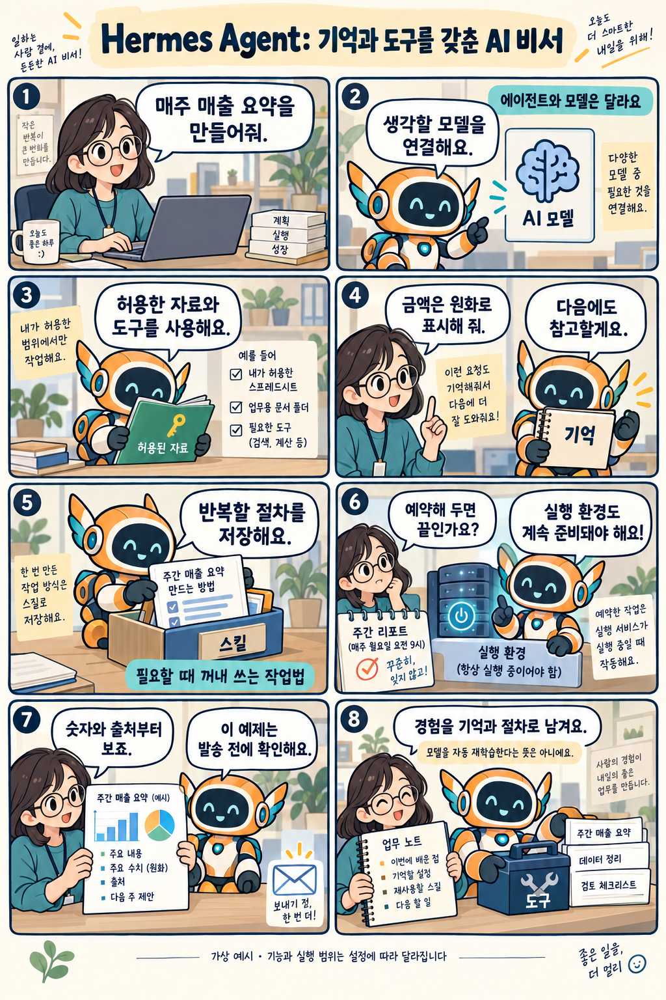

# Hermes Agent: 기억과 작업 절차를 쌓아 가는 AI 에이전트

확인일: 2026-10-04 (KST)

## 1. 질문과 핵심 답변

Hermes Agent는 무엇이고 기억·스킬·예약 작업은 어떻게 다른가요?

Hermes Agent는 Nous Research가 만든 오픈소스 AI 에이전트입니다. 선택한 언어 모델과 도구를 연결해 웹 조사·파일 처리·코딩 등의 작업을 수행하고, 메모와 작업 절차를 저장해 다시 활용할 수 있습니다.

여기서는 같은 이름의 Hermes 언어 모델 계열과 구분해 Hermes Agent를 설명합니다. Hermes 모델만 연결해야 하는 것은 아닙니다.

## 2. 쉬운 설명

매주 매출 보고서를 만드는 가상 사례를 생각해 보세요. 먼저 사용할 모델, 읽어도 되는 매출 자료와 도구를 연결합니다.

'금액은 원화로 표시해 달라'는 선호는 메모로 남기고, 자료를 정리하는 순서는 스킬로 저장합니다. 다음 작업에서 필요한 기억과 절차를 다시 참고하는 방식입니다.

예약한 시간에 실행 환경이 동작하면 보고서를 만들 수 있습니다. 이 예제에서는 사람이 숫자와 출처를 확인한 뒤 발송하도록 정했으며, 실제 설정이나 실행 결과는 아닙니다.

### memory와 skills, 그리고 cron

메모(memory)는 선호나 환경처럼 다시 참고할 사실을 선별해 저장한 기록입니다. 과거 대화를 검색하는 기능도 있지만, 모든 대화를 완벽하게 기억한다는 뜻은 아닙니다.

스킬(skill)은 필요할 때 불러오는 작업 절차 문서입니다. 메모·스킬을 저장하고 고치는 방식의 자기개선은 모델의 학습 가중치를 자동으로 바꾸는 것과 다릅니다.

예약 작업(cron)을 실행하려면 이를 처리하는 연결 서비스(gateway)와 실행 컴퓨터가 동작해야 합니다. 원격 서버에서 실행한다면 접속용 노트북을 끄는 것과 실행 서버를 끄는 것은 다릅니다.

## 3. 그림으로 이해하기

가상의 주간 매출 보고서 사례로 모델·기억·스킬·예약 작업을 구분합니다.

이해를 위한 가상 사례 · 실제 Hermes 화면이나 실행 결과 아님

## 4. 관련 도구와 비교

Hermes Agent와 Claude Code는 직접 작업을 수행하는 에이전트 도구이며, 일부 기능과 활용 범위가 겹칩니다. Herdr는 여러 터미널과 작업 상태를 관리하는 데 초점을 둡니다.

아래 표는 공식 자료의 역할과 이용 방식을 비교합니다. 같은 조건으로 성능을 측정한 결과는 아닙니다.

Hermes Agent·Herdr·Claude Code 비교(공개 문서 기준, 성능 비교 아님)

| 비교 항목 | Hermes Agent | Herdr | Claude Code |
| --- | --- | --- | --- |
| 역할 | 선택한 모델·도구를 연결해 작업을 이어가는 AI 에이전트 소프트웨어 | 여러 터미널 AI 도구의 작업 상태를 모아 보여주는 터미널 작업공간 관리 도구(AI 모델 아님) | 코드를 읽고 파일을 수정하고 명령을 실행하는 개발 중심 도구이며 메모·스킬·자동화도 지원 |
| 이용 예 | 웹 조사·파일 처리·코딩 등 반복 업무를 메모·스킬과 함께 이어가기 | 여러 AI 코딩 에이전트의 터미널을 한곳에서 작업공간·탭·창으로 관리하기 | 코드 읽기·파일 수정·명령 실행이 필요한 개발 작업을 진행하기 |
| 실행 관리 | CLI·데스크톱·메신저로 접속, 로컬·원격 서버·격리 환경에서 실행, cron 예약은 gateway·실행 컴퓨터가 함께 동작해야 함 | 백그라운드 서버에서 실행을 관리하고 접속 화면과 분리 | 터미널·IDE·데스크톱·웹 등에서 사용하며, CLI는 터미널 관리 도구 안에서도 실행 가능 |

메모와 반복 절차를 활용한 여러 업무를 구성하려면 Hermes Agent의 기능을, 코드 개발이 중심이라면 Claude Code의 작업 흐름을 살펴볼 수 있습니다. Claude Code도 메모·스킬·자동화를 지원합니다.

여러 에이전트의 터미널 상태를 함께 관리하려는 목적에는 Herdr가 해당합니다. 도구의 역할이 겹치는 부분과 함께 사용할 수 있는 부분을 구분해 선택하면 됩니다.

비교 출처: [Hermes Agent: Documentation](https://hermes-agent.nousresearch.com/docs/) · [Herdr: Concepts](https://herdr.dev/docs/concepts/) · [Claude Code: Overview](https://code.claude.com/docs/en/overview)

## 5. 자세한 설명

Hermes Agent는 명령창(CLI), 데스크톱, Telegram·Discord·Slack 같은 메신저 연결을 지원합니다. 메신저는 요청과 결과를 주고받는 통로이며, 실제 작업은 Hermes와 도구가 실행되는 환경에서 이뤄집니다.

명령 실행 위치는 로컬 컴퓨터, 원격 서버, 격리된 실행 환경 등으로 구성할 수 있습니다. 접속 화면과 실제 실행 위치를 나눠 생각하면 이해하기 쉽습니다.

사용할 도구와 실행 위치, 명령 승인 방식, 메모·스킬 저장 승인 여부를 설정할 수 있습니다. 사람의 확인을 거칠 범위는 설정에 따라 달라집니다.

스킬은 작업 방법을 담은 문서이므로, 외부에서 가져온 스킬의 내용과 연결할 권한을 확인해야 합니다. 접근 가능한 파일과 명령에는 실제 변경이 일어날 수 있습니다.

코드는 MIT 라이선스로 공개돼 있습니다. 모델 API·구독, 외부 도구, 서버·하드웨어 비용까지 모두 무료라는 뜻은 아닙니다.

로컬에 설치하더라도 외부 모델이나 도구를 연결하면 요청 내용이 해당 서비스로 전달될 수 있습니다. 데이터가 어디로 전달되는지는 설치 위치뿐 아니라 연결 설정에 달려 있습니다.

## 6. 헷갈리기 쉬운 점

- Hermes Agent와 Hermes 언어 모델은 구분해야 합니다. 에이전트는 선택한 모델과 도구를 연결해 작업을 수행합니다.

- 메모와 스킬을 갱신하는 것은 모델 가중치를 자동 재학습하는 것과 다릅니다. 저장한 내용이 잘못되었거나 오래됐는지도 확인해야 합니다.

- 예약을 저장해도 실행 서비스와 컴퓨터가 꺼져 있으면 정해진 시간의 실행을 보장할 수 없습니다.

- 로컬 설치가 외부 전송 없음을 뜻하지는 않습니다. 연결한 모델·도구에 따라 요청 내용이 외부 서비스로 전달될 수 있습니다.

- 오픈소스 라이선스와 운영 비용은 별개입니다. 모델·도구·실행 환경의 비용 조건을 각각 확인해야 합니다.

- 이 문서의 매출 보고서와 발송 전 확인 절차는 설명용 사례입니다. 모든 설치에 같은 승인 절차가 자동 적용되는 것은 아닙니다.

## 7. 출처와 확인일

확인일: 2026-10-04 (KST)

[Hermes Agent: Documentation](https://hermes-agent.nousresearch.com/docs/) · [Hermes Agent: Memory](https://hermes-agent.nousresearch.com/docs/user-guide/features/memory) · [Hermes Agent: Skills](https://hermes-agent.nousresearch.com/docs/user-guide/features/skills)

추가 참고: [Hermes Agent: Cron](https://hermes-agent.nousresearch.com/docs/user-guide/features/cron) · [Hermes Agent: Quickstart](https://hermes-agent.nousresearch.com/docs/getting-started/quickstart) · [Hermes Agent: Security](https://hermes-agent.nousresearch.com/docs/user-guide/security) · [Hermes Agent: FAQ](https://hermes-agent.nousresearch.com/docs/reference/faq) · [Hermes Agent GitHub](https://github.com/NousResearch/hermes-agent) · [Herdr: Concepts](https://herdr.dev/docs/concepts/) · [Claude Code: Overview](https://code.claude.com/docs/en/overview)

## 8. 이해도 확인

보기를 고르면 즉시 채점됩니다. 오답은 바로 다른 보기를 다시 선택할 수 있으며, 정답을 맞히면 해설을 확인합니다.

점수는 각 문항의 첫 선택 기준입니다. 응시 기록은 저장하지 않습니다.

### 문제 1. Hermes Agent와 같은 이름의 Hermes 언어 모델은 어떻게 구분하나요?

1. Hermes Agent는 Hermes 모델 안에 내장된 하나의 기능이다
2. Hermes Agent를 쓰려면 반드시 Hermes 모델을 선택해야 한다
3. Hermes Agent는 선택한 모델과 도구를 연결해 작업을 이어가는 소프트웨어다
4. Hermes Agent와 Hermes 모델은 같은 제품의 다른 이름일 뿐이다

정답: 3번

해설: Hermes Agent는 선택한 언어 모델과 도구를 연결해 작업을 이어가는 에이전트 소프트웨어이며, 별도의 Hermes 모델 계열과는 다른 제품입니다.

### 문제 2. 매출 자료 정리 순서를 skill로 저장했습니다. 이 저장이 뜻하는 것은 무엇인가요?

1. 재사용할 수 있는 작업 절차 문서로 남는다
2. 모델 가중치가 그 정리 순서로 다시 훈련된다
3. 앞으로 모든 작업에 그 순서가 강제로 적용된다
4. 서버의 cron 예약이 자동으로 새로 생긴다

정답: 1번

해설: skill은 필요할 때 불러오는 재사용 작업 절차 문서이며, 이를 저장하는 것은 모델 가중치의 재훈련과는 다릅니다.

### 문제 3. 원격 서버와 Hermes의 예약 실행 서비스가 켜져 있고, 자료 연결과 권한도 준비됐습니다. 접속용 노트북만 끈 경우 예약 시각의 작업은 어떻게 되나요?

1. 노트북이 꺼졌으므로 예약 작업은 즉시 전부 취소된다
2. 노트북을 다시 켜야만 예약된 작업이 실행을 시작한다
3. 예약 저장 여부와 무관하게 서버가 알아서 모든 조건을 보완한다
4. 원격 서버에서 예약 작업을 실행할 수 있다

정답: 4번

해설: cron 예약은 운영 gateway와 실행 컴퓨터가 함께 동작해야 실행되며, 원격 서버가 그 조건을 갖추고 있다면 접속용 노트북은 꺼도 됩니다.

### 문제 4. 로컬에 Hermes Agent를 설치하고 설정에서 외부 모델을 선택했습니다. 이때 유의해야 할 점은 무엇인가요?

1. 로컬 설치가 모든 외부 전송을 자동 차단한다
2. 설정한 외부 모델에 요청 내용이 전달될 수 있다
3. 설정과 관계없이 모든 모델 업체에 전송된다
4. 외부 모델을 골라도 반드시 로컬 모델만 실행한다

정답: 2번

해설: 로컬에 설치해 실행해도 설정에서 외부 모델이나 도구를 연결하면 요청 내용이 그 외부 서비스로 전달될 수 있습니다.

### 문제 5. '금액은 원화로 표시해 달라'는 선호와 '보고서를 단계별로 작성하는 절차'를 Hermes Agent에 각각 저장하려 합니다. 올바른 연결은 무엇인가요?

1. 선호는 skill, 절차는 memory
2. 둘 다 memory로만 저장해야 한다
3. 선호는 memory, 절차는 skill
4. 둘 다 skill로만 저장해야 한다

정답: 3번

해설: 사실·선호·진행 정보를 선별해 남기는 것은 memory의 역할이고, 재사용할 작업 절차 문서를 저장하는 것은 skill의 역할입니다.
