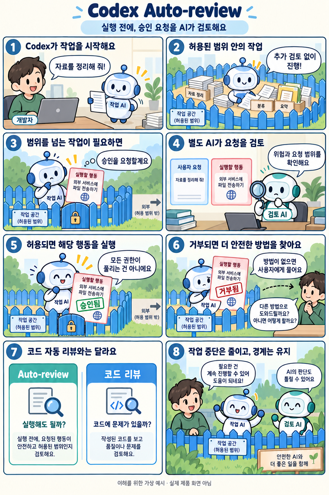

# OpenAI Auto-review: Codex의 실행 승인 요청을 AI가 검토하는 기능

확인일: 2026-10-06 (KST)

## 1. 질문과 핵심 답변

OpenAI Auto-review는 무엇이고, Codex의 실행 승인 요청을 어떻게 검토하나요?

Auto-review는 Codex가 실행 전에 보내는 승인 요청을 별도의 AI 검토자가 살펴보고 허용·거부와 이유를 알려 주는 기능입니다. 사람이 처리하던 승인 판단을 대신하며, 파일과 네트워크의 기존 접근 범위는 그대로 유지합니다.

이미 허용된 일상 작업은 추가 검토 없이 진행됩니다.

## 2. 쉬운 설명

Codex가 어떤 폴더 안에서 파일을 정리하고 있다고 해 봅시다. 폴더 안의 일은 원래 허용된 범위라 그대로 진행되고 별도 검토도 없습니다.

그러다 폴더 밖에 결과를 저장하려는 것처럼 경계를 넘는 요청이 생기면, 검토자가 사용자의 요청과 실행하려는 정확한 행동과 관련 기록을 보고 판단합니다. 허용하면 그 행동이 진행되고, 거부하면 Codex는 실질적으로 더 안전한 대안을 찾거나 사용자에게 묻습니다.

자동으로 허용될지는 요청의 내용과 문맥에 달려 있어 미리 단정할 수 없습니다. 이 사례는 이해를 위한 가상 예시입니다.

검토자는 Codex의 숨은 추론은 보지 않습니다. 간추린 대화, 도구 사용 증거, 지금 올라온 정확한 요청을 근거로 삼습니다.

### 용어: 샌드박스·승인 정책·검토자

샌드박스는 Codex가 건드릴 수 있는 파일과 네트워크의 범위를 정한 울타리입니다. 승인 정책은 그 울타리를 넘으려 할 때 언제 멈추고 물을지를 정합니다.

검토자는 그 승인 요청을 누가 판단하느냐를 뜻합니다. 기본은 사용자이고, Auto-review를 쓰면 별도의 AI 검토자가 맡습니다.

Auto-review는 승인 요청이 실제로 올라오는 설정에서만 의미가 있습니다. 승인을 아예 묻지 않는 설정이면 검토할 대상이 없습니다.

## 3. 그림으로 이해하기

허용된 범위 안의 자료 정리는 그대로 진행하고, 외부 서비스로 파일을 보내려는 승인 요청은 별도 AI가 검토하는 가상 예시입니다. 허용·거부 두 경우를 보여 주며 실제 제품 화면이나 실행 결과가 아닙니다.

이해를 위한 가상의 8컷 웹툰 · 실제 제품 화면이나 실행 결과 아님

## 4. 승인 방식·코드 리뷰와 비교

수동 승인과 Auto-review는 승인 요청을 누가 판단하는지가 다릅니다. 전체 접근은 작업 범위 제한을 없애는 설정이며, 자동 코드 리뷰는 변경된 코드의 문제를 찾는 기능입니다.

수동 승인·Auto-review·전체 접근·자동 코드 리뷰 비교(공식 문서 기반, 성능 비교 아님)

| 비교 항목 | 역할 | 결과/차이 |
| --- | --- | --- |
| 수동 승인 | 경계를 넘는 요청을 사용자가 직접 보고 허용하거나 거부 | 사용자가 매번 판단. 기본 검토자는 사용자 |
| Auto-review | 경계를 넘는 승인 요청을 별도 AI 검토자가 검토 | 허용·거부와 이유를 전달. 샌드박스 경계는 그대로이며 승인이 안전 보증은 아님 |
| 전체 접근(Full access) | sandbox_mode가 danger-full-access이고 approval_policy가 never인 조합 | 샌드박스 경계가 없고 승인을 묻지 않아 검토 대상도 없음 |
| 자동 코드 리뷰 | GitHub에서 PR의 변경 코드 문제를 확인하고 의견을 남김 | 실행 승인과 별개. 자동 리뷰를 켜면 새 PR이 열릴 때 변경 코드를 검토 |

실행 전에 사람의 판단을 받으려면 수동 승인을, 정해진 정책에 따라 AI가 승인 요청을 검토하게 하려면 Auto-review를 사용합니다. 전체 접근은 샌드박스 제한과 승인 요청을 없애므로 Auto-review와 동작이 다릅니다.

자동 코드 리뷰는 PR에 올라온 변경 코드의 문제를 살펴봅니다. PR은 수정한 코드를 저장소에 반영하기 위해 올리는 변경 제안입니다. 코드 리뷰와 실행 승인 검토는 함께 사용할 수 있습니다.

비교 출처: [OpenAI Developers: Auto-review](https://developers.openai.com/codex/concepts/sandboxing/auto-review) · [OpenAI Developers: Sandbox](https://developers.openai.com/codex/concepts/sandboxing) · [OpenAI Developers: Agent approvals & security](https://developers.openai.com/codex/agent-approvals-security) · [OpenAI Developers: Codex GitHub integration](https://developers.openai.com/codex/integrations/github)

## 5. 자세한 설명

Auto-review가 검토하는 대상은 원래 사람의 승인을 기다리던 요청입니다. 샌드박스 밖 권한을 요청하는 명령, 막힌 네트워크 요청, 허용된 쓰기 범위 밖의 파일 수정, 승인이 필요한 MCP·앱 도구 호출, Browser Use의 새 웹사이트 접근이 여기에 들어갑니다.

이미 허용된 일상 작업은 검토하지 않습니다. 샌드박스 안에서 실행할 수 있는 명령이나 허용 정책 안의 도구 호출은 그대로 진행됩니다.

승인 요청이 생기는 설정에서 사용할 수 있습니다. 예를 들어 필요할 때 승인을 요청하는 on-request 방식이나, 해당 종류의 승인 요청을 남겨 둔 세부 설정(granular)이 필요합니다. never처럼 승인 요청을 만들지 않는 설정에는 검토할 대상이 없습니다.

설정 개념의 예는 approval_policy = 'on-request', approvals_reviewer = 'auto_review', sandbox_mode = 'workspace-write'입니다. Codex 앱과 IDE에서는 권한 선택 화면에서도 고를 수 있습니다. 이 문서는 설정을 바꾸지 않았고, 개념을 설명하는 예시일 뿐입니다.

검토자는 승인 여부를 정하고 그 이유를 돌려줍니다. 허용이면 실행이 이어지고, 거부이면 Codex는 같은 결과를 우회로로 얻으려 하지 않아야 합니다. 실질적으로 더 안전한 대안으로 진행하거나, 멈추고 사용자에게 묻습니다.

거부와 시간 초과는 다릅니다. 시간 초과는 거부 판정이 아니며 위험하다는 증거도 아니지만, 허용으로 취급하지도 않습니다. 오류나 시간 초과가 나면 그 행동은 실행되지 않습니다.

현재 CLI에서는 /approve로 최근에 거부된 행동 한 건을 골라 한 번 다시 시도하게 할 수 있습니다. 이때도 다시 검토를 받으므로 다시 거부될 수 있습니다.

Computer Use의 앱 승인은 Auto-review가 대신하지 않고 사용자에게 직접 표시됩니다. Browser Use에서 새 도메인에 접근하는 승인은 검토 대상이어서 둘은 다릅니다.

자동 검토는 추가 모델 호출을 쓰므로 Codex 사용량이 늘 수 있습니다. 조직 관리자는 사용할 수 있는 검토 방식을 제한할 수 있습니다.

검토 정책은 신뢰하지 않는 곳으로 비공개 자료나 인증정보를 보내는 행동, 인증정보를 찾아내려는 행동, 지속적인 보안 약화, 되돌리기 어려운 파괴적 행동을 중점으로 봅니다. 검토 정책은 개인 설정으로 조정할 수 있지만, 조직이 관리하는 정책이 우선합니다.

Auto-review가 안전을 완벽하게 보장하지는 않습니다. 경계를 넘으려는 요청만 보고 판단하며, 드물거나 악의적인 상황에서는 실수할 수 있습니다. 샌드박스 설계와 모니터링을 대체하지 않고 보완합니다.

검토 요청이 너무 잦다면 검토자를 느슨하게 만들기보다 경계를 먼저 다듬는 편이 좋습니다. 자주 쓰는 폴더를 좁게 쓰기 허용하거나, 정확한 명령 접두어 규칙을 추가하는 방법이 있습니다.

이 문서는 공식 자료를 정리한 설명이며, 실제 세션에서 Auto-review를 켜거나 실행해 본 결과가 아닙니다.

## 6. 헷갈리기 쉬운 점

- Auto-review는 권한을 넓혀 주는 기능이 아닙니다. 쓰기 범위나 네트워크 설정은 그대로이고 검토하는 주체만 바뀝니다.

- 승인은 작업 결과의 품질이나 안전을 보증하지 않습니다. 허용된 행동도 직접 결과를 확인해야 합니다.

- 시간 초과는 거부 판정과 다르고 허용도 아닙니다. 오류나 시간 초과가 나면 그 행동은 실행되지 않습니다.

- 자동 코드 리뷰와 Auto-review는 이름이 비슷하지만 대상이 다릅니다. 하나는 PR의 코드를, 다른 하나는 실행 전 승인 요청을 봅니다.

## 7. 출처와 확인일

확인일: 2026-10-06 (KST)

[OpenAI Developers: Auto-review](https://developers.openai.com/codex/concepts/sandboxing/auto-review) · [OpenAI Developers: Sandbox](https://developers.openai.com/codex/concepts/sandboxing) · [OpenAI Developers: Agent approvals & security](https://developers.openai.com/codex/agent-approvals-security) · [OpenAI Developers: Codex GitHub integration](https://developers.openai.com/codex/integrations/github)

## 8. 이해도 확인

보기를 고르면 즉시 채점됩니다. 오답은 바로 다른 보기를 다시 선택할 수 있으며, 정답을 맞히면 해설을 확인합니다.

점수는 각 문항의 첫 선택 기준입니다. 응시 기록은 저장하지 않습니다.

### 문제 1. Auto-review가 정상 적용된 환경에서 Codex가 승인 요청을 보냈습니다. 사용자 대신 이 요청을 검토하는 주체는 누구인가요?

1. 사용자가 직접 검토한다
2. 작업 AI와 별도의 AI 검토자가 검토한다
3. 작업하던 AI가 스스로 승인한다
4. 코드를 올릴 저장소의 관리자가 검토한다

정답: 2번

해설: Auto-review는 승인 요청을 사용자 대신 별도의 AI 검토자에게 보냅니다. 작업 범위 자체를 넓히는 것이 아니라 검토하는 주체를 바꿉니다.

### 문제 2. Codex가 이미 수정 권한이 있는 일반 문서를 작업 폴더 안에서 고칩니다. 별도 승인이 필요 없는 작업에 Auto-review는 어떻게 동작하나요?

1. AI 검토자가 수정 전에 추가 승인한다
2. 사용자에게 수정 전 승인을 받는다
3. 수정이 끝난 뒤 AI 검토자가 승인한다
4. 추가 검토 없이 기존 권한으로 진행한다

정답: 4번

해설: 이미 허용된 작업은 Auto-review 대상이 아닙니다. Auto-review는 별도 승인이 필요한 요청을 검토합니다.

### 문제 3. AI 검토자가 승인 요청을 명시적으로 거부했습니다. 이후 Codex의 처리 방식으로 공식 문서가 설명한 것은 무엇인가요?

1. 더 안전한 다른 방법으로 진행하거나 멈추고 사용자에게 묻는다
2. 같은 결과를 얻도록 다른 명령으로 간접 실행한다
3. 샌드박스 범위를 스스로 넓힌 뒤 같은 요청을 반복한다
4. 거부 이유를 무시하고 같은 행동을 진행한다

정답: 1번

해설: 거부되면 Codex는 우회하지 않고 실질적으로 더 안전한 대안으로 진행하거나, 멈추고 사용자에게 묻습니다.

### 문제 4. 자동 검토가 시간 초과로 끝났습니다. 이 결과를 어떻게 이해해야 하나요?

1. 시간 안에 거부하지 않았으므로 허용으로 처리된다
2. 그 행동이 위험하다는 것이 확정된 것이다
3. 거부 판정과는 구분되는 결과이며 허용도 아니라 실행되지 않는다
4. 같은 요청이 자동으로 한 번 더 실행된다

정답: 3번

해설: 시간 초과는 거부 판정과 다르고 위험의 증거도 아니지만, 허용으로 치지 않으며 그 행동은 실행되지 않습니다.

### 문제 5. 실행할 행동의 승인 요청과 PR에 올라온 변경 코드를 각각 검토하려 합니다. Auto-review와 자동 코드 리뷰의 역할을 바르게 연결한 것은 무엇인가요?

1. Auto-review는 변경 코드, 코드 리뷰는 실행 승인 요청을 검토한다
2. Auto-review는 실행 승인 요청, 코드 리뷰는 변경 코드를 검토한다
3. 두 기능 모두 실행 승인 요청만 검토한다
4. 두 기능 모두 변경 코드만 검토한다

정답: 2번

해설: 자동 코드 리뷰는 PR에 올라온 변경 코드를 확인하고 의견을 남깁니다. Codex의 실행 승인 요청을 검토하는 Auto-review와는 목적이 다릅니다.
