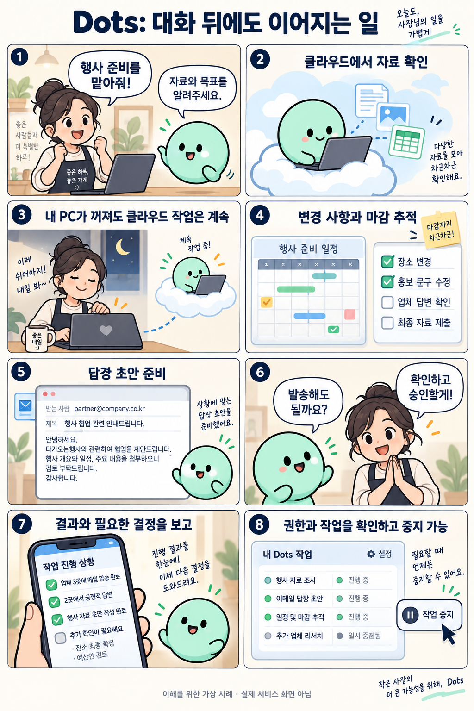

# dots: 항상 켜져 있는 OpenAI의 클라우드 에이전트

확인일: 2026-10-02 (KST)

## 1. 질문과 핵심 답변

OpenAI의 dots는 무엇이고 기존 챗봇과 어떻게 다른가요?

Dots는 GPT-6 Astra를 기반으로 클라우드에서 맡은 일을 이어가는 AI 에이전트입니다. 대화가 끝나도 작업을 진행하고, 결과나 사람의 판단이 필요한 결정을 알려줍니다.

사용자는 목표, 참고 자료, 허용할 행동과 알림 방식을 정해 일을 맡길 수 있습니다.

## 2. 쉬운 설명

비서를 한 명 고용했다고 생각해 보세요. 이 비서는 사무실 문을 닫고 퇴근해도 자기 사무실에서 혼자 일을 계속합니다. 다만 비서가 당신 책상의 서류나 당신 컴퓨터를 직접 만지려면, 당신이 컴퓨터를 켜 두고 그 '사무실 출입증'을 미리 건네줘야 합니다.

또 메신저로만 연락이 되는 사람에게 금고 비밀번호까지 자동으로 넘어가진 않는 것처럼, dots도 메시지로 대화하는 권한과 특정 앱·PC를 다루는 권한을 따로 허락받아야 움직입니다.

### 에이전트란?

에이전트는 목표와 허용된 도구를 바탕으로 필요한 단계를 진행하는 AI입니다. dots는 자료 조사, 문서 작성, 코드 작업 등을 이어가고 사용자에게 결과나 필요한 결정을 알려줍니다.

쉬지 않고 모든 순간에 계산한다는 의미는 아니며, 필요에 따라 멈췄다가 다시 작업할 수 있습니다.

## 3. 그림으로 이해하기

이해를 위한 가상 사례 · 실제 dots 제품 화면 아님

## 4. 비슷한 제품과 비교

Dots와 Claude(Cowork 기능)는 둘 다 클라우드에서 작업을 이어가는 에이전트라는 점에서 비슷한 목적을 가진 제품입니다. 다만 강조하는 방식과 산출물의 형태가 다릅니다.

| 비교 항목 | Dots | Claude (Cowork 기능) |
| --- | --- | --- |
| 강조점 | 지속적인 책임과 메모, 여러 연락 통로로 결정 보고 | 문서·표·조사 같은 작업 산출물 생성 |
| 도구 연결 | 메시지 채널·연동 앱·로컬 PC로 나뉜 권한 | 파일과 연결 도구, 예약 작업 지원 |
| PC가 꺼졌을 때 | 클라우드 작업은 이어지고 PC 작업만 대기 | 클라우드 작업은 이어지고 로컬 파일·앱 작업은 데스크톱 앱이 온라인이어야 함 |
| 화면 | ChatGPT 메시지 채널 중심 | Pro/Max에 채팅·Cowork 통합 화면이 점진적으로 공개됨 |

둘 다 클라우드 작업은 PC가 꺼져도 이어지며, 로컬 파일이나 앱을 다루려면 해당 데스크톱 앱이 온라인 상태여야 합니다.

지속적인 책임과 알림 흐름을 중시한다면 dots의 연결 구조를 확인해 보고, 현재 문서 작업이나 연결 도구를 활용 중이라면 Claude Cowork를 검토해 볼 수 있습니다. 이는 우열이 아니라 선택의 문제이며, 둘 다 반복 작업을 이어갈 수 있습니다.

비교 출처: [ChatGPT Help: Meet dots](https://learn.chatgpt.com/docs/dots) · [Claude Support: Cowork and chat are one Claude](https://support.claude.com/en/articles/16761823-claude-cowork-and-chat-are-one-claude) · [Claude Support: Use Claude Cowork on web, desktop, and mobile](https://support.claude.com/en/articles/15520349-use-claude-cowork-on-web-desktop-and-mobile)

## 5. 자세한 설명

확인일(2026-10-02 KST) 기준 공개 자료를 보면, dots는 대화 맥락과 ChatGPT 메모리, 그리고 dots 자신이 남긴 메모를 함께 참고해 작업을 이어갑니다. 연결은 메시지 채널(ChatGPT, Slack, Teams, 전화), 연동 앱·플러그인, 로컬 PC 세 종류로 나뉘고 각각 권한이 독립적입니다.

작업 중 문제가 생겨 멈추는 '오류로 인한 중지'와, 사용자가 일시정지(Pause)나 위임한 개별 작업(Activity에서 각각 중지)을 끄는 '의도적인 중지'는 서로 다른 경로로 처리됩니다.

이용 한도 측면에서는 dots와의 대화 자체는 ChatGPT 사용 한도에 포함되지 않지만, dots가 Work나 Codex 쪽에 만들거나 이어가는 작업은 그 제품들의 한도를 그대로 적용받습니다.

요금제에는 더 깊은 작업(deep work)을 위한 별도 할당량이 포함되어 있고, 출시 첫 달에는 그 한도가 확장된다고 설명합니다.

2026-10-02 확인 기준, Pro 100/200/500 요금제는 유럽경제지역(EEA)·영국·스위스를 제외한 18세 이상 사용자에게 제공되고, Business Premium은 전 세계에 점진적으로 공개되며, Enterprise는 기본적으로 꺼져 있고 워크스페이스 관리자가 켜야 쓸 수 있습니다.

한국 사용자에게 이 기능이 언제, 어떤 형태로 보일지는 이번에 확인한 자료만으로 단정할 수 없습니다.

첫 dot은 해당 Pro 또는 Business Premium 요금제에 추가 비용 없이 포함된다고 공식 발표는 설명합니다.

이용 가능한 계정에서 데스크톱 앱 또는 데스크톱 브라우저로 처음 만들고, 지원 업데이트가 있는 모바일 앱에서 이어서 대화할 수 있습니다. 모바일 웹은 지원되지 않습니다.

승인 필요 여부는 행동과 권한, 안전 규칙에 따라 결정되며, 사용자가 정한 규칙으로 기본 안전 제한을 없앨 수는 없습니다.

클라우드 작업은 PC가 꺼져 있어도 이어집니다. 로컬 파일·앱을 다루려면 해당 PC가 온라인 상태이고 ChatGPT 앱이 열려 있어야 합니다.

## 6. 헷갈리기 쉬운 점

dots가 클라우드에서 계속 일한다고 해도, 로컬 PC 파일이나 설치된 앱을 다루려면 그 PC가 온라인 상태이고 ChatGPT 앱이 켜져 있어야 합니다. PC가 꺼져 있으면 그 부분 작업은 PC가 다시 연결될 때까지 진행되지 않습니다.

메시지 채널 연결과 앱·PC 연결은 서로 다른 권한입니다. Slack이나 전화로 dots와 대화할 수 있다고 해서 메일함이나 컴퓨터 파일에 자동으로 접근하는 것은 아닙니다.

오류 때문에 작업이 멈추는 것과, 사용자가 일시정지나 위임 작업 중지로 멈추는 것은 서로 다른 상황입니다. 사용자가 중지시켰다고 해서 이미 처리된 행동이 자동으로 되돌아가지는 않습니다.

Pro 요금제의 지역 제한(EEA·영국·스위스 제외)이나 Business Premium·Enterprise의 점진적 공개 방식 때문에, 한국을 포함한 특정 지역에서 지금 바로 이 기능이 보인다고 단정할 수 없습니다.

이 문서의 그림은 이해를 돕기 위해 문서 작성자가 만든 가상의 흐름이며, 실제 dots 제품 화면이나 실제 작업 결과가 아닙니다.

## 7. 출처와 확인일

[OpenAI: Introducing dots](https://openai.com/index/introducing-dots/) · [ChatGPT Help: Meet dots](https://learn.chatgpt.com/docs/dots)

확인일: 2026-10-02 (KST)
