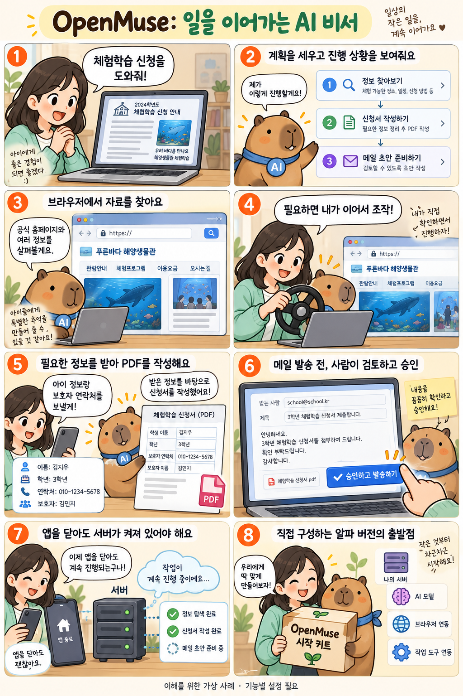

# OpenMuse: 브라우저와 파일로 일을 이어가는 AI 비서

확인일: 2026-10-06 (KST)

## 1. 질문과 핵심 답변

OpenMuse는 무엇이고, 앱을 닫아도 일이 이어지며 브라우저와 파일을 쓰는 개인 AI 비서는 어떻게 동작하나요?

OpenMuse는 CopilotKit이 공개한 개인 AI 비서 앱입니다. 브라우저로 자료를 읽고 파일을 다루며, 사용자가 계획과 결과를 확인하고 필요한 행동을 승인할 수 있습니다.

iOS·Android·웹 화면과 서버 코드를 MIT 라이선스로 공개하며, 직접 설치하고 구성해 쓰는 알파 단계입니다.

## 2. 쉬운 설명

학교 체험학습 신청서를 준비하는 가상 사례를 생각해 보세요. 필요한 연동 설정을 마친 뒤 사용자가 신청서 준비를 맡기면, 비서가 자료 조사·양식 작성·답장 준비의 계획을 보여 줍니다.

브라우저로 학교와 체험 장소의 공개 안내를 읽습니다. 직접 조작할 일이 생기면 사용자가 같은 브라우저 세션을 이어받을 수 있습니다.

학생 이름처럼 필요한 정보는 사용자에게 물어보고, 지원되는 PDF 양식의 입력란을 채워 새 사본을 만듭니다. 답장 초안과 첨부물을 보여 준 뒤 발송 승인을 받습니다.

사용자는 활동 화면에서 진행 상황과 결과를 확인합니다. 이것은 기능을 이해하기 위한 이야기이며 실제 신청이나 메일 발송을 수행한 결과는 아닙니다.

### 용어: 하네스·AG-UI·MCP·직접 운영

하네스는 모델이 일하도록 도구, 기록, 실행 환경을 묶은 구성입니다. OpenMuse는 이 작업 과정을 사용자가 보고 조작하는 앱 화면과 연결합니다.

AG-UI는 에이전트와 앱 사이에서 대화, 작업 상태, 사용자 입력을 주고받는 규약입니다. MCP는 에이전트와 도구·데이터의 연결을 담당하며, 두 규약은 함께 사용할 수 있습니다.

직접 운영(self-hosted)은 서버를 자신이 준비하고 관리한다는 뜻입니다. 모델이나 대화 저장 서비스 등 연결한 구성에 따라 외부 서비스도 사용합니다.

## 3. 그림으로 이해하기

학교 신청서의 자료 조사부터 PDF 작성과 발송 승인까지 설명하는 가상 사례입니다. PDF 작성은 OpenMuse가 지원하는 입력 양식을 기준으로 합니다.

이해를 위한 가상 사례 · 실제 제품 화면이나 실행 결과 아님

## 4. 비슷한 제품과 비교

세 프로젝트는 모두 AI 도구지만 목적이 다릅니다. 아래는 공개 저장소 설명을 바탕으로 한 용도 비교이며 성능 순위가 아닙니다.

OpenMuse·Hermes Agent·OpenGenerativeUI 비교(공개 자료 기반, 성능 비교 아님)

| 비교 항목 | OpenMuse | Hermes Agent | OpenGenerativeUI |
| --- | --- | --- | --- |
| 목적 | 일을 맡기고 결과를 이어 보는 개인 비서 앱 | 장기 기억, 스킬 축적, 도구 실행, 예약 작업, 위임 | 알고리즘·차트·3D·조작 UI를 생성하는 공개 예제 |
| 사용 화면 | iOS·Android·web 앱의 채팅, 활동, 문서, 브라우저 화면 | CLI와 Telegram·Discord·Slack 등 메신저 | 웹 채팅과 격리된 iframe 속 HTML/SVG 결과 |
| 구성할 부분 | 서버, 작업 처리기, 브라우저, 모델과 Intelligence 키 | 로컬·Docker·SSH·클라우드 실행 환경과 모델 선택 | Next.js와 LangChain Deep Agents, 디자인 시스템·스킬·문서 조립 MCP 서버 |

앱에서 진행 상황·브라우저·문서 결과를 함께 보여 주는 개인 비서를 만들려면 OpenMuse의 구성을 참고할 수 있습니다. 대화 사이의 기억과 스킬, 터미널·메신저의 반복 작업을 살펴보려면 Hermes Agent가 관련 있습니다.

OpenGenerativeUI는 차트나 조작 가능한 설명 화면을 만드는 데 초점이 있습니다. 같은 CopilotKit 계열이라도 어떤 사용자 경험을 만들려는지에 따라 참고할 프로젝트가 달라집니다.

비교 출처: [GitHub: CopilotKit/OpenMuse](https://github.com/CopilotKit/OpenMuse) · [GitHub: NousResearch/hermes-agent](https://github.com/NousResearch/hermes-agent) · [GitHub: CopilotKit/OpenGenerativeUI](https://github.com/CopilotKit/OpenGenerativeUI)

## 5. 자세한 설명

OpenMuse는 앱 화면 뒤에서 자체 서버와 작업 처리기를 실행합니다. 위임된 작업은 서버가 켜져 있으면 앱을 닫아도 이어집니다.

앱 안의 후속 대화 대기열은 별개입니다. 대화 입력창에 메시지를 줄 세워 둔 것만으로 모두 지속적인 서버 작업이 되는 것은 아닙니다.

브라우저는 Chromium 세션과 프로필을 유지합니다. Take control을 누르면 사용자가 에이전트가 쓰던 같은 브라우저 세션을 이어서 조작합니다.

선택 사항인 Docker Linux 작업공간에서는 파일을 편집하고 제한된 명령을 실행합니다. 현재 터미널의 네트워크는 꺼져 있고, 웹 접근은 별도 브라우저 처리기가 맡습니다.

PDF는 지원되는 양식의 입력란을 채우는 방식입니다. 스캔된 종이를 글자로 읽는 OCR과 추가 양식 종류는 개발 예정이며, 지출 요약은 은행에 직접 연결하는 대신 가져온 CSV 거래 파일을 사용합니다.

Gmail·Calendar를 실제로 쓰려면 Google 계정을 연결해야 합니다. 메일 발송이나 일정 변경에는 쓰기 권한과 작업별 검토·승인이 필요합니다.

확인한 저장소 README와 Rich Threads 문서는 모든 실행 모드에 CopilotKit Intelligence 프로젝트 키가 필요하다고 설명합니다. 샘플 흐름은 모델·Google 계정·Docker 없이 볼 수 있지만, 이 대화 저장 서비스의 설정은 따로 필요합니다.

개발 환경으로 Node 24 LTS와 pnpm 11.19.0을 안내합니다. 실제 AI 작업에는 모델 제공자 설정을 추가하고, 사용할 기능에 따라 브라우저·Docker·Google 연동을 준비합니다.

MIT로 공개된 앱 코드와 운영에 쓰는 서비스는 구분됩니다. Intelligence는 별도 서비스이며, 모델 API·호스팅 등의 이용 조건과 비용도 각각 적용됩니다.

현재는 소유자 한 명이 직접 운영하는 알파 버전입니다. 자동 예약·결제, 기기 푸시 알림, 음성·이미지 생성, 전체 데스크톱 가상 머신과 다중 사용자 운영은 로드맵에 있습니다.

공식 검증 문서에는 실제 Google 계정 연동, 자유로운 주제의 AI 작업, Android 기기 설치 등의 추가 확인 항목이 남아 있습니다. 이 문서는 공개 자료를 정리한 것으로 OpenMuse 자체를 설치하거나 실행해 본 결과는 아닙니다.

## 6. 헷갈리기 쉬운 점

- 앱을 닫아도 작업을 이어가려면 서버와 작업 처리기가 실행 중이어야 합니다. 서버가 설치된 컴퓨터를 끄는 것은 다릅니다.

- 작업 취소는 이미 발송한 메일을 회수하지 않습니다. 승인 후 외부 서비스에 전달된 요청은 취소 시점에 따라 완료될 수도 있습니다.

- AG-UI 호환 연결을 이용해 구성을 바꿀 수 있지만, 모든 하네스가 설정 없이 연결되는 것은 아닙니다. OpenBot의 실제 세션 연결도 아직 개발 예정입니다.

- 브라우저와 선택적인 Linux 작업공간은 서로 다른 구성입니다. 현재 작업공간이 전체 그래픽 데스크톱을 제공한다는 뜻은 아닙니다.

## 7. 출처와 확인일

확인일: 2026-10-06 (KST)

[GitHub: CopilotKit/OpenMuse](https://github.com/CopilotKit/OpenMuse) · [OpenMuse: FEATURES](https://github.com/CopilotKit/openmuse/blob/main/docs/FEATURES.md) · [OpenMuse: VERIFICATION](https://github.com/CopilotKit/openmuse/blob/main/docs/VERIFICATION.md) · [OpenMuse: ROADMAP](https://github.com/CopilotKit/openmuse/blob/main/ROADMAP.md) · [AG-UI: Introduction](https://docs.ag-ui.com/introduction) · [OpenMuse: Rich Threads와 실행 조건](https://github.com/CopilotKit/openmuse/blob/main/docs/RICH-THREADS.md)

추가 참고: [GitHub: NousResearch/hermes-agent](https://github.com/NousResearch/hermes-agent) · [GitHub: CopilotKit/OpenGenerativeUI](https://github.com/CopilotKit/OpenGenerativeUI)

## 8. 이해도 확인

보기를 고르면 즉시 채점됩니다. 오답은 바로 다른 보기를 다시 선택할 수 있으며, 정답을 맞히면 해설을 확인합니다.

점수는 각 문항의 첫 선택 기준입니다. 응시 기록은 저장하지 않습니다.

### 문제 1. CopilotKit이 공개한 OpenMuse 저장소에는 어떤 종류의 소프트웨어가 들어 있나요?

1. 새 언어 모델의 학습 가중치
2. 앱 화면과 서버를 갖춘 개인 AI 비서 애플리케이션
3. 에이전트용 웹 검색 API만
4. 에이전트와 화면을 연결하는 통신 규약만

정답: 2번

해설: OpenMuse는 개인 AI 비서 애플리케이션입니다. 앱 화면, 서버, 작업 처리기와 브라우저 구성을 갖추며, AG-UI 같은 규약을 활용합니다.

### 문제 2. OpenMuse의 위임 작업이 실행 중입니다. 앱을 닫은 뒤에도 계속 처리할 수 있는 상태는 어느 것인가요?

1. 앱과 서버를 모두 종료했다
2. 앱만 열어 두고 서버와 작업 처리기를 종료했다
3. 서버는 켜 두고 작업을 취소했다
4. 앱은 닫았지만 서버와 작업 처리기는 실행 중이다

정답: 4번

해설: 위임 작업은 서버의 작업 처리기가 수행합니다. 앱을 닫아도 계속할 수 있지만 서버와 작업 처리기가 실행 중이어야 합니다.

### 문제 3. 에이전트가 보고 있는 페이지를 사용자가 직접 조작하려고 Take control을 눌렀습니다. 이어받는 것은 무엇인가요?

1. 에이전트가 사용하던 같은 브라우저 세션
2. 기존 상태가 없는 새 브라우저 세션
3. 페이지의 정지된 스크린샷 파일
4. 에이전트를 실행하는 컴퓨터의 전체 데스크톱

정답: 1번

해설: Take control은 에이전트가 사용하던 Chromium 브라우저 세션을 사람이 이어서 조작하도록 여는 기능입니다.

### 문제 4. Gmail을 연결하고 쓰기 권한도 허용했습니다. OpenMuse가 만든 답장 초안을 실제로 발송하기 전에 추가로 필요한 절차는 무엇인가요?

1. Google 계정을 다시 연결하기
2. PDF를 첨부하기만 하기
3. 그 발송 건의 내용을 검토하고 승인하기
4. 초안이 저장된 뒤 일정 시간 기다리기

정답: 3번

해설: 계정의 쓰기 권한과 개별 발송 승인은 별개입니다. OpenMuse는 각 발송 건의 내용을 검토하고 승인받는 절차를 거칩니다.

### 문제 5. 현재 OpenMuse의 PDF 양식 작성 기능이 대상으로 하는 문서는 무엇인가요?

1. 입력 필드가 없는 스캔 사진 PDF
2. OpenMuse가 지원하는 입력 필드를 가진 PDF 양식
3. 암호를 모르는 열람 잠금 PDF
4. 모든 종류의 PDF를 형식에 관계없이 처리

정답: 2번

해설: 현재 지원 범위는 지원되는 PDF 양식의 입력 필드를 채우는 작업입니다. 스캔본 OCR과 추가 필드 종류는 개발 예정입니다.
