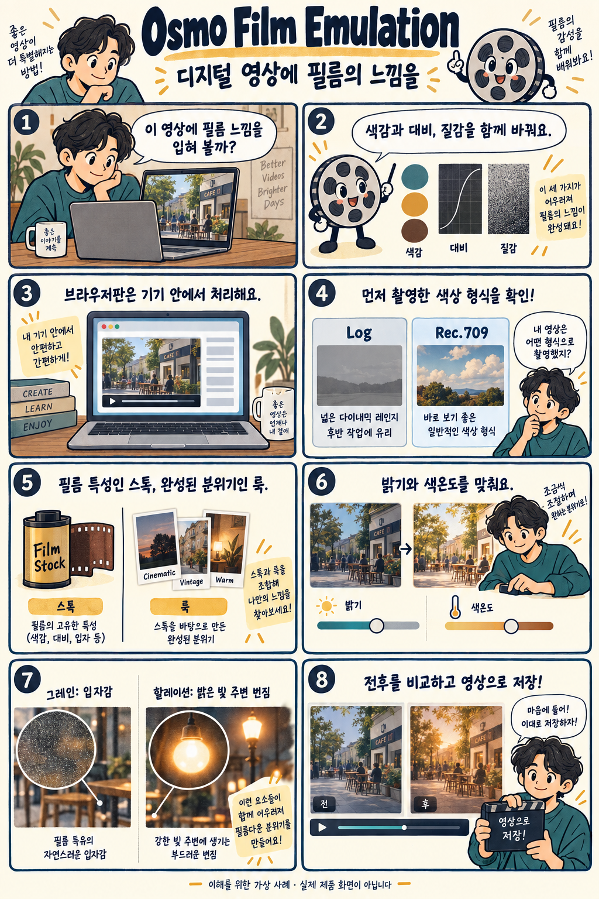

# Osmo Film Emulation: 영상에 필름의 색감과 질감을 입히는 도구

확인일: 2026-10-05 (KST)

## 1. 질문과 핵심 답변

Osmo Film Emulation은 무엇이고 영상에 필름 느낌을 만드는 방법은 색 변환표와 어떻게 다른가요?

Osmo Film Emulation은 촬영한 영상의 색감·대비·입자감·빛 번짐을 조절해 필름으로 찍은 듯한 분위기를 만드는 색보정 도구입니다. 공식 안내에 따르면 브라우저에서 무료로 사용할 수 있고, 영상은 업로드 없이 기기 안에서 처리됩니다.

촬영해 둔 영상을 가져와 원하는 필름 느낌을 고르고 조절하는 방식입니다.

## 2. 쉬운 설명

카페에서 찍은 영상을 따뜻한 필름 영화처럼 꾸미는 가상 사례를 생각해 보세요. 먼저 영상이 어떤 촬영 설정으로 기록됐는지 확인합니다.

Log는 밝기 정보를 후보정하기 좋게 기록하는 방식입니다. 일반 Rec.709 영상과 입력 해석이 다르므로 실제 촬영한 형식을 맞춰야 하며, Osmo는 파일에 해당 메타데이터가 있으면 입력을 자동으로 선택한다고 안내합니다.

필름 스톡이나 완성된 룩을 고르고 밝기와 색온도, 대비를 조절합니다. 필름의 느낌을 결정하는 색감과 질감을 따로 생각하면 이해하기 쉽습니다.

마지막으로 입자감인 그레인과 밝은 경계 주변의 빛 번짐인 할레이션을 조절하고, 전후 모습을 비교한 뒤 저장합니다.

### 용어: 스톡·룩·그레인·할레이션·LUT

필름 스톡(stock)은 특정 필름의 색과 밝기 반응을 본뜬 설정입니다. 룩(look)은 그 스톡을 바탕으로 완성한 색보정 분위기나 템플릿입니다.

그레인(grain)은 필름 특유의 입자감입니다. 할레이션(halation)은 밝은 광원이나 경계 주변에 나타나는 붉은색·주황색 계열의 빛 번짐을 재현하는 효과입니다.

3D LUT는 입력 색을 정해진 출력 색으로 바꾸는 색 대응표입니다. 색감과 대비를 바꾸는 데 유용하지만, 프레임마다 달라지는 입자나 주변 픽셀로 퍼지는 빛 번짐까지 LUT 하나로 만들 수는 없습니다.

## 3. 그림으로 이해하기

촬영한 색상 형식 확인부터 필름 느낌 선택과 영상 저장까지 설명하는 가상 사례입니다.

이해를 위한 가상 카페 영상 사례 · 실제 제품 화면이나 실제 결과 아님

## 4. 비슷한 제품과 비교

세 제품 모두 영상에 필름 느낌을 더하며, 올바른 카메라 입력과 색상 설정이 필요합니다. 아래는 공식 자료에서 확인한 작업 방식의 비교이며, 같은 영상으로 품질을 측정한 결과는 아닙니다.

Osmo Film Emulation·Dehancer·FilmConvert Nitrate 비교(공식 자료 기반, 직접 성능 비교 아님)

| 비교 항목 | Osmo Film Emulation | Dehancer | FilmConvert Nitrate |
| --- | --- | --- | --- |
| 작업 환경 | 브라우저에서 시작하며 Resolve·Premiere 플러그인도 안내 | 여러 편집기 플러그인과 데스크톱·모바일·온라인 제품군 | 영상 편집기에 연결하는 플러그인 |
| 주요 조절 기능 | 필름 스톡·룩, 밝기와 색, 그레인·할레이션 | 필름·인화 모사, 그레인·할레이션·빛의 확산·필름 손상 등 | 카메라 팩, 필름 스톡, 밝기 영역별 그레인 조절·LUT 내보내기 |
| 시작할 때 확인 | 브라우저판 무료 안내, 촬영한 입력 프로파일 확인 | 제품·편집기별 지원 효과와 호환 조건 확인 | 카메라 모델·촬영 프로파일 선택, 일회성 구매 및 Halation 상품 조건 확인 |

Dehancer의 모든 효과가 모든 제품에 공통으로 들어가는 것은 아닙니다. FilmConvert도 Halation 기능을 안내하며, 구매한 상품에 포함되는지는 별도 확인이 필요합니다.

짧은 영상으로 필름 느낌을 익히려면 Osmo의 브라우저 작업 흐름을 살펴볼 수 있습니다. 다양한 필름 효과를 세부 조절하려면 Dehancer를, 카메라별 입력과 입자 조절을 중심으로 작업하려면 Nitrate를 함께 비교할 수 있습니다.

이는 활용 목적에 따른 비교입니다. 제공하는 설정 수나 가격만으로 결과의 품질 순위를 정할 수는 없습니다.

비교 출처: [Osmo: Film Emulation](https://osmo.inc/tools/film-emulation) · [Dehancer: Features](https://www.dehancer.com/features) · [FilmConvert: Nitrate](https://www.filmconvert.com/nitrate) · [FilmConvert: Nitrate tutorials](https://www.filmconvert.com/tutorials?Product=nitrate)

## 5. 자세한 설명

공식 페이지는 필름 스톡과 룩을 합쳐 126개의 선택지를 안내합니다. 영화용 필름 느낌, 흑백, 오래된 인화물 같은 분위기를 골라 조절할 수 있습니다.

노출·색온도·색조·대비·채도 등으로 색을 맞추고 그레인·할레이션으로 질감을 더합니다. 효과를 많이 넣는 것보다 인물과 장면이 원하는 분위기로 보이는지 전후를 비교하는 것이 사용 순서를 이해하는 데 도움이 됩니다.

입력 색상 설정은 실제 촬영한 프로파일과 맞아야 합니다. Osmo는 그 입력을 바탕으로 Log 변환과 필름 처리를 연결하므로, 별도 변환을 무조건 한 번 더 적용하는 방식으로 이해하지 않아야 합니다.

공식 안내에는 Sony S-Log3, Canon Log, DJI D-Log, Apple Log 등 다양한 입력과 일반 Rec.709 영상이 포함됩니다. 자동 감지에 필요한 정보가 없으면 카메라 설정이나 촬영 기록을 참고해 입력을 확인할 수 있습니다.

브라우저판은 로그인과 워터마크 없이 쓰고, 원본 해상도로 MP4 또는 ProRes 4444를 내보낼 수 있다고 안내합니다. 영상의 기기 내 처리 역시 제작사의 설명이며, 이번 문서 작성에서 실제 영상 처리나 통신 측정은 하지 않았습니다.

DaVinci Resolve·Premiere Pro용 플러그인과 Resolve용 DCTL도 안내합니다. 편집기에 연결해 쓰려면 해당 배포물의 설치 방법과 호환 버전·이용 조건을 확인해야 합니다.

## 6. 헷갈리기 쉬운 점

- 이 문서의 Osmo는 다양한 카메라 영상을 다루는 색보정 도구입니다. DJI Osmo 카메라 전용 기능을 뜻하지 않습니다.

- 126개는 필름 스톡과 룩을 합친 안내 수치입니다. 서로 다른 실물 필름만 126종이라는 뜻은 아닙니다.

- Log와 일반 영상의 입력 설정을 잘못 맞추면 색과 대비가 의도와 달라질 수 있습니다. 효과를 고르기 전에 촬영한 형식을 확인하세요.

- 원본 해상도로 저장한다는 말은 가로·세로 픽셀 크기를 유지한다는 뜻입니다. 압축 손실이 없거나 원본에 없던 세부 정보가 복원된다는 의미는 아닙니다.

- 영상의 기기 내 처리는 브라우저판에 대한 공식 설명입니다. 사이트가 모든 상황에서 오프라인으로 동작한다는 보장은 별개입니다.

## 7. 출처와 확인일

확인일: 2026-10-05 (KST)

[Osmo: Film Emulation](https://osmo.inc/tools/film-emulation) · [FilmConvert: Nitrate tutorials](https://www.filmconvert.com/tutorials?Product=nitrate)

추가 참고: [Dehancer: Features](https://www.dehancer.com/features) · [FilmConvert: Nitrate](https://www.filmconvert.com/nitrate)

## 8. 이해도 확인

보기를 고르면 즉시 채점됩니다. 오답은 바로 다른 보기를 다시 선택할 수 있으며, 정답을 맞히면 해설을 확인합니다.

점수는 각 문항의 첫 선택 기준입니다. 응시 기록은 저장하지 않습니다.

### 문제 1. 카페에서 이미 촬영한 영상을 필름 영화처럼 보이게 만들고 싶습니다. Osmo Film Emulation의 역할은 무엇인가요?

1. 글 설명으로 새 영상을 생성한다
2. 기존 영상의 색감·대비·질감을 필름처럼 처리한다
3. 낮은 해상도 영상을 높여 복원한다
4. DJI Osmo 카메라의 촬영 설정을 바꾼다

정답: 2번

해설: Osmo Film Emulation의 역할은 촬영한 영상의 색감·대비·질감을 필름처럼 바꾸는 후처리입니다.

### 문제 2. Sony S-Log3로 촬영한 영상인데 입력 자동 감지에 필요한 정보가 없습니다. 입력 설정은 무엇을 기준으로 골라야 하나요?

1. 최종 저장할 파일 이름
2. 원하는 필름 룩의 이름
3. 그레인 효과의 세기
4. 실제 촬영에 사용한 Sony S-Log3 설정

정답: 4번

해설: 입력 설정은 영상을 어떤 형식으로 촬영했는지에 맞춥니다. 원하는 출력 분위기인 룩이나 그레인 설정은 촬영 프로파일을 대신하지 않습니다.

### 문제 3. 밝은 전등의 경계에 생기는 붉은 빛 번짐과 필름의 입자감을 각각 재현하는 효과는 무엇인가요?

1. 빛 번짐은 할레이션, 입자감은 그레인
2. 빛 번짐은 그레인, 입자감은 할레이션
3. 빛 번짐은 할레이션, 입자감은 노출
4. 빛 번짐은 채도, 입자감은 그레인

정답: 1번

해설: 할레이션은 밝은 경계 주변의 붉은색·주황색 계열 빛 번짐을, 그레인은 필름 특유의 입자감을 재현합니다.

### 문제 4. 주변 픽셀이나 시간 정보를 쓰지 않는 고정 3D LUT만 적용할 때, 그 LUT 자체로 만들 수 없는 효과는 무엇인가요?

1. 색조를 따뜻하게 바꾸는 것
2. 입력 색을 정해진 출력 색으로 대응시키는 것
3. 프레임마다 달라지는 입자와 밝은 부분 주변의 공간적 번짐
4. 특정 밝기 영역의 색을 바꾸는 것

정답: 3번

해설: 3D LUT는 입력 색을 출력 색으로 바꾸는 고정 색 대응표라 색 표현에는 유용합니다. 프레임마다 달라지는 입자와 공간적인 빛번짐은 LUT만으로 구현할 수 없습니다.

### 문제 5. 공식 설명에 따르면 Osmo Film Emulation 브라우저판은 불러온 영상을 어디에서 가공하나요?

1. 영상을 업로드한 Osmo 서버
2. 사용자 기기의 브라우저 안
3. 촬영한 카메라 본체 안
4. 편집 프로그램 제작사의 서버

정답: 2번

해설: 공식 안내상 브라우저판의 영상 처리는 사용자 기기 안에서 이뤄지며 원본 영상을 업로드하지 않습니다.
